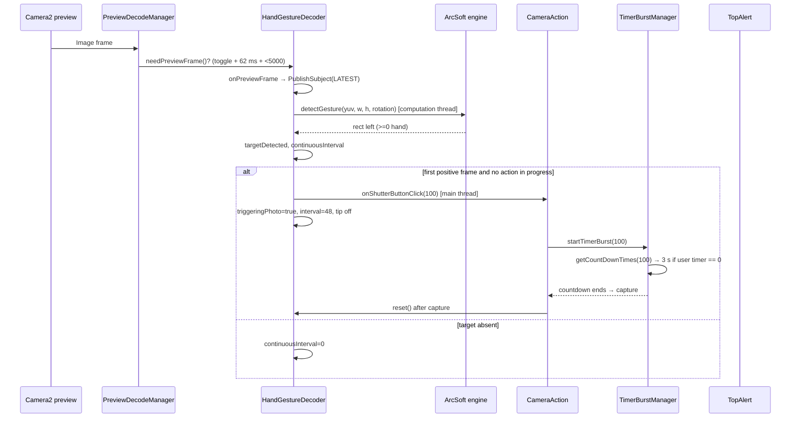

# 01 — Palm (hand-gesture) shutter

Feature toggle: **Palm shutter** (`pref_hand_gesture`). Showing an open palm to the
camera starts the shutter countdown. On the stock Poco F4 camera this is not a
standalone feature: it is one `Decoder` in the preview-decode pipeline whose
output is `CameraAction.onShutterButtonClick(TriggerConstant.MODE_HAND_GESTURE)`
(= 100), which feeds the same timer/capture path as the on-screen shutter.

## 1. Stock architecture

### 1.1 Components

| Component | Path | Role |
|---|---|---|
| `HandGestureDecoder` | `decompiled2/sources/com/android/zxing/decoders/HandGestureDecoder.java` | Android-side decode loop, 16 fps throttle, debounce, trigger, tip state |
| `HandGesture` (JNI facade) | `decompiled2/sources/com/android/camera/handgesture/HandGesture.java` | Loads three native libs and exposes `init`, `detectGesture`, `setLogLevel`, `unInit` |
| `PreviewDecodeManager` | `decompiled2/sources/com/android/zxing/PreviewDecodeManager.java` | Dispatches `Image` frames to registered decoders, owns start/stop/quit |
| `Decoder` | `decompiled2/sources/com/android/zxing/Decoder.java` | Base throttle: `getDecodeInterval()`, `getDecodeMaxCount()`, `mDecodingCount` |
| `TriggerConstant.MODE_HAND_GESTURE` | `decompiled2/sources/com/android/camera/constant/TriggerConstant.java:15` | Trigger id 100 |
| `ImageActionImpl.onShutterButtonClick` | `decompiled2/sources/com/android/camera/module/image/ImageActionImpl.java:187` | Normal capture entry for trigger 100 |
| `TimerBurstManager.getCountDownTimes/startTimerBurst` | `decompiled2/sources/com/android/camera/timerburst/TimerBurstManager.java:171,308` | Forces the 3 s timer for trigger 100 |
| `DataItemRunning` | `decompiled2/sources/com/android/camera/data/data/runing/DataItemRunning.java:43,526,723,765` | `pref_hand_gesture` toggle + transient `pref_hand_gesture_status` |
| `ExtraTopConfigUtils.getHandGestureExtraUpdater` | `decompiled2/sources/com/android/camera/fragment/modeui/topconfig/ExtraTopConfigUtils.java:34-39` | Top-config toggle bound to `pref_hand_gesture`, label `hand_gesture_tip` |
| Native engine | `native/lib/arm64-v8a/libhandengine.arcsoft.so` | ArcSoft hand engine; exports `ARC_HE_Init`, `ARC_HE_Process`, `ARC_HE_Uninit` |
| Native glue | `libcamera_arcsoft_handgesture.so`, `libcamera_handgesture_mpbase.so` | JNI bridge and MediaPipe base used by the stock engine |

### 1.2 Native surface

`HandGesture.java:9-25` loads, in order:

```
camera_handgesture_mpbase
handengine.arcsoft
camera_arcsoft_handgesture
```

and declares:

```java
native void init(int cameraId);
native int  detectGesture(byte[] yuv, int width, int height, int rotation);
native void setLogLevel(int level);   // 2 when Log.isLoggable("hand_gesture_dump", 3)
native void unInit();
```

`detectGesture` returns a decoded hand rectangle "left" coordinate: `>= 0` means a
hand was found, `< 0` means no hand (`HandGestureDecoder.java:206-211`). The JNI
receives the packed preview buffer plus the rotation computed as
`(sensorOrientation - orientation + 360) % 360`
(`HandGestureDecoder.java:135-141`, `VertexHelper.NUM_ROUND_POINT == 360`).

### 1.3 Lifecycle and frame rate

`PreviewDecodeManager` registers the decoder as type `1` and forwards every preview
`Image` unless the activity is in the background
(`PreviewDecodeManager.java:29-58`). `HandGestureDecoder`:

- `getDecodeInterval()` = **62 ms** → 16 fps (`HandGestureDecoder.java:148-150`,
  constant `DETECTION_FRAMES_PER_SECOND = 16` at line 35);
- `getDecodeMaxCount()` = **5000** frames per start (`:34,153`);
- `needPreviewFrame(Image)` = `CameraSettings.isHandGestureOpen() && super.needPreviewFrame(image)`
  (`:166-167`), so frames are dropped while the toggle is off, the decoder is stopped,
  or the 5000-frame budget is exhausted;
- `init(cameraId)` records the camera id/sensor orientation and sets
  `setHandGestureRunning(true)` (`:158-163`);
- `startDecode()` marks decoding on and, when the toggle is open, posts a
  `PreviewImage(1, cameraId)` command that calls the JNI `init` (`:196-201`);
- `quit()` posts `PreviewImage(3, ...)` → JNI `unInit()` and completes the Rx stream
  (`:179-183`).

Frames are funnelled through an RxJava `PublishSubject` with
`BackpressureStrategy.LATEST`, decoded on `Schedulers.computation()`, and the result
consumer runs on the main thread (`HandGestureDecoder.java:47-59`). The native call
itself is therefore off the UI thread; only the trigger logic is main-thread.

### 1.4 Trigger and debounce logic

The result consumer (`HandGestureDecoder.java:205-247`):

```text
if rect >= 0: targetDetected = true
else:         targetDetected = false; continuousInterval = 0
if triggeringPhoto: return                       // latched after a shot (:213)

if continuousInterval > 0:  continuousInterval--  // (:216-217)
else if targetDetected:
    if CameraAction and RunningState present
       and !isDoingAction() and !isBlockSnap():
        if mode is changing: skip                // (:223-227)
        onShutterButtonClick(100)
        triggeringPhoto = true
        continuousInterval = 48                  // (:229-234)
        setHandGestureRunning(false)             // hides tip while shooting
```

Key facts:

- The first positive detection after the interval reaches 0 fires **immediately**;
  there is no multi-frame hold in stock.
- After firing, `triggeringPhoto` latches. The consumer returns early on every later
  frame until `reset()` (`:185-192`) clears the latch, so the 48-frame value set at
  `:231` is not actually consumed. `reset()` is called from `TimerBurstManager`
  (countdown cancel, `:49-53`) and from `Camera2ModuleHandler` on capture-finish
  message 57 (`Camera2ModuleHandler.java:135-142`).
- The guards prevent a palm from starting a capture while another action is running
  or the mode is switching.
- `mTipShowInterval = 16` (`:40,234`) and `setHandGestureRunning(false/true)` drive
  the "Palm shutter" top-alert tip: the tip is hidden for ~16 frames after a trigger
  and re-shown on a later frame (`:236-246`).

### 1.5 What the trigger actually starts

`ImageActionImpl.onShutterButtonClick(100)`:

1. mode 100 calls `activity.onUserInteraction()` (`ImageActionImpl.java:212-213`);
2. `TimeBurstProtocol.startTimerBurst(100)` (`:231`) → `TimerBurstManager.startTimerBurst`
   (`TimerBurstManager.java:308-330`);
3. `getCountDownTimes(100)` (`:171-203`) returns the user's timer setting, except:

```java
if (i != 100 || !CameraSettings.isHandGestureOpen()) {
    return CameraSettings.getCountDownTimes();
}
int countDownTimes = CameraSettings.getCountDownTimes();
if (countDownTimes != 0) {
    return countDownTimes;
}
return 3;
```

So **when the user timer is 0, palm shutter forces a 3 s countdown**; a user timer of
5 s / 10 s is respected. The countdown is run by `CameraTimer` with
`.setStartDelay(100).setRepeatTimes(1)` (`:297`), and only then does the normal
capture path execute (trigger mode 100 is stored at `ImageActionImpl.java:243`).

### 1.6 Settings keys and strings

| Key | Constant | Default | Semantics |
|---|---|---|---|
| `pref_hand_gesture` | `CameraSettings.KEY_HAND_GESTURE` (`CameraSettings.java:285`), `DataItemRunning.DATA_RUNING_HAND_GESTURE` (`DataItemRunning.java:42`) | `false` (`CameraSettings.isHandGestureOpen()` reads `getBoolean(..., false)`, `:2461-2466`) | User toggle; also the per-frame gate in `needPreviewFrame` |
| `pref_hand_gesture_status` | `CameraSettings.KEY_HAND_GESTURE_STATUS` (`:286`), `DataItemRunning.DATA_RUNING_HAND_GESTURE_STATUS` (`:43`) | `false` (`DataItemRunning.java:526-527`) | Transient "tip visible / running" flag written by `setHandGestureRunning` (`:723-724,162,232,238`) |
| `pref_delay_capture_mode` | `ComponentRunningTimer.getKey()` (`ComponentRunningTimer.java:55`) | `"0"` (`:40-42`) | User timer 0/3/5/10 s; values 3/5/10 override the palm-forced 3 s |

Timer values are read through `CameraSettings.getCountDownTimes()`
(`CameraSettings.java:805-807` → `ComponentRunningTimer.getTimer()`), which returns
the integer seconds stored under `pref_delay_capture_mode`.

Support gate: `DataItemRunning.supportHandGesture()` (`:765-766`) is set only in
`reInitSupport` for three still-capture mode indices (163, 171, 205) on a device
whose capability check passes (`DataItemRunning.java:667-674`). `false` there makes
`isHandGestureOpen()` return `false` regardless of the preference. [INFERENCE] The
mode indices are photo-oriented modes; the exact names are not needed by the
reimplementation.

Strings (`apktool_out/res/values/strings.xml:1153-1154`):

```xml
<string name="hand_gesture_open_tip">Show your palm to the camera to start timer</string>
<string name="hand_gesture_tip">Palm shutter</string>
```

Chinese (`values-zh-rCN/strings.xml:868-869`): `伸出手掌开始倒计时拍照`, `手势拍照`.

### 1.7 Stock control flow



## 2. Reimplementation

Package `dev.pocof4.camera.gesture`:

| File | Purpose |
|---|---|
| `PalmGestureDetector.kt` | `Feature`/`FrameListener`: MediaPipe inference, worker thread, stats, release |
| `PalmHoldStateMachine.kt` | Pure-Kotlin hold/cooldown/debounce logic (JVM-tested) |
| `PalmPoseHeuristics.kt` | Pure-Kotlin landmark sanity gate for Open_Palm |
| `app/src/test/java/dev/pocof4/camera/gesture/*` | JVM tests |

### 2.1 Mapping

| Stock component | Reimplementation |
|---|---|
| `HandGestureDecoder` (frame gate, throttle) | `CameraEngine` already throttles to 62 ms; `PalmGestureDetector.onFrame` drops frames while inference is busy |
| `HandGesture` + ArcSoft libs | MediaPipe `GestureRecognizer` with `assets/gesture_recognizer.task`, IMAGE mode, one hand |
| `detectGesture` rectangle output | `GestureRecognizerResult.gestures()[0][0]`; label `Open_Palm` + score |
| continuous-interval / `triggeringPhoto` latch | `PalmHoldStateMachine`: 600 ms hold + 3 s cooldown + stale-timestamp guard |
| `CameraAction.onShutterButtonClick(100)` | `onTrigger()` callback; `MainActivity.onPalmDetected()` runs the 3 s countdown, then `capture(CaptureReason.PALM)` |
| `getCountDownTimes(100)` forcing 3 s | `MainActivity.onPalmDetected` always counts 3 s (the reimplementation has no user timer setting) |
| `pref_hand_gesture` | `AppSettings.palmShutter` (`KEY_PALM = "pref_hand_gesture"`) |
| `pref_hand_gesture_status` tip | Not implemented; `PalmGestureDetector.stats` is the UI/log surface |
| `hand_gesture_open_tip` / `hand_gesture_tip` | Reimplementation string `palm_tip` (owned by MainActivity) |

### 2.2 Detection pipeline

```mermaid
sequenceDiagram
    participant CE as CameraEngine (16 fps)
    participant PGD as PalmGestureDetector
    participant W as palm-gesture thread
    participant MP as MediaPipe GestureRecognizer
    participant SM as PalmHoldStateMachine
    participant MA as MainActivity

    CE->>PGD: onFrame(PreviewFrame, timestampNs)
    alt stopped or inference in flight
        PGD-->>CE: drop (KEEP_ONLY_LATEST semantics)
    else idle
        PGD->>W: execute(detect)
    end
    W->>PGD: ensureRecognizer() (lazy, once)
    W->>W: frame.toBitmap(applyRotation=false)
    W->>MP: recognize(bitmap, ImageProcessingOptions(rotationDegrees))
    MP-->>W: gestures + hand landmarks
    W->>W: Open_Palm && score >= 0.6 && pose gate
    W->>SM: onDetection(timestampNs, label, score)
    alt Event.TRIGGERED and still running
        W->>MA: onTrigger()  (background thread; MainActivity launches a coroutine)
    end
```

Configuration:

- Model: `assets/gesture_recognizer.task` (bundled);
- `RunningMode.IMAGE`, `setNumHands(1)`;
- hand detection / presence / tracking confidence = **0.5** (MediaPipe defaults);
- Open_Palm acceptance score = **0.6** (`PalmHoldStateMachine.DEFAULT_MIN_CONFIDENCE`);
- bitmap is **not** pre-rotated: `toBitmap(applyRotation = false)` and
  `ImageProcessingOptions.setRotationDegrees(frame.rotationDegrees)` give the same
  upright inference as the stock `(sensorOrientation - orientation + 360) % 360`
  JNI argument, without an extra full-frame rotation copy.

### 2.3 State machine

`PalmHoldStateMachine.onDetection(timestampNs, gestureName, confidence)` returns:

| Event | Meaning |
|---|---|
| `NONE` | not a palm / below threshold; hold is cleared |
| `HOLD_STARTED` | palm accepted; 600 ms window starts (also after a >500 ms frame gap) |
| `HOLDING` | palm still inside the window |
| `TRIGGERED` | window reached 600 ms; fire **once**, arm 3 s cooldown |
| `COOLDOWN` | within 3 s of a trigger; palms cannot accumulate hold time |
| `STALE` | timestamp ≤ newest processed timestamp; state untouched |

Constants (nanoseconds, measured from `PreviewFrame.timestampNs`):

| Constant | Value | Rationale |
|---|---|---|
| `DEFAULT_HOLD_NANOS` | 600 ms | Requirement 500–800 ms; ~10 frames at 16 fps |
| `DEFAULT_COOLDOWN_NANOS` | 3.0 s | 48 cooldown frames × 62 ms (`HandGestureDecoder.java:231,148-150`) |
| `DEFAULT_MAX_PALM_GAP_NANOS` | 500 ms | normal frame gap is 62 ms; larger gap = stalled stream, restart hold |
| `DEFAULT_MIN_CONFIDENCE` | 0.6 | Open_Palm classifier score gate |

Additional invariants:

- Triggering clears the hold; the next trigger requires **cooldown expiry plus a new
  600 ms hold**, so a palm left in frame cannot re-fire instantly.
- A non-palm label, a low-confidence palm, or `null` (no hand) resets the window.
- Duplicate or backwards timestamps are ignored (`STALE`), which makes the machine
  immune to a repeated frame at the trigger boundary.
- All timing uses frame timestamps; no `Thread.sleep` or wall-clock calls.

### 2.4 Threading and failure handling

- `start()`/`stop()` only flip flags, (un)register the listener and post work — they
  never create/close the recognizer on the caller/UI thread.
- A private single-thread daemon executor serialises creation, inference and release.
  `AtomicBoolean frameInFlight` drops frames while one inference is pending, matching
  the stock `BackpressureStrategy.LATEST` / CameraX `KEEP_ONLY_LATEST`.
- `stop()` removes the listener, resets the state machine, and posts
  `GestureRecognizer.close()` behind any in-flight inference.
- If model creation or inference throws (missing asset, unsupported delegate), the
  exception is logged, `stats.lastError` is set, and the feature becomes inert. Model
  creation is retried on the next `start()`, not once per frame.
- Exceptions from the `onTrigger` consumer are caught and never kill the worker.
- Frames delivered after `stop()` are ignored; a trigger is suppressed if `running`
  turned false while inference was in flight.

`PalmGestureStats` (volatile snapshot): `active`, `recognizerReady`, `lastGesture`,
`lastScore`, `lastEvent`, `triggers`, `lastTriggerTimestampNs`, `lastError`.

### 2.5 Deviations and limitations

- **Engine**: ArcSoft `ARC_HE_*` is replaced by MediaPipe; gesture labels, confidence
  calibration and latency differ. The stock engine works on vendor YUV buffers,
  the reimplementation on CameraX RGBA_8888 converted to a Bitmap.
- **Immediate vs held trigger**: stock fires on the first positive frame; the
  reimplementation deliberately requires a 600 ms hold to reject false positives.
- **Cooldown**: stock's 48-frame setting is masked by the `triggeringPhoto` latch;
  the reimplementation uses a real 3 s timestamp cooldown plus a fresh hold window.
- **Tip UI and `pref_hand_gesture_status`**: not reproduced; MainActivity shows a
  countdown status line instead.
- **Guards**: the stock `RunningState.isDoingAction()` / `isBlockSnap()` /
  `modeChanging()` checks have no direct analogue; MainActivity's `captureLock` and
  `countdownJob` reject overlapping captures.
- **Mode gating**: the stock supports the feature only in three still-capture modes
  on capable hardware; the reimplementation exposes it in every still mode via
  `AppSettings.palmShutter`.
- **User timer**: the stock honours a non-zero user timer; the reimplementation always
  counts 3 s.
- Hardware-bound: ArcSoft binaries are arm64-v8a vendor libraries and cannot be
  redeployed; MediaPipe runs on CPU and is hardware independent.

## 3. Verification

### 3.1 JVM unit tests

Run (coordinator, single build):

```bash
./tools/gradle-8.7/bin/gradle -p reimpl test
```

`PalmHoldStateMachineTest` asserts:

| Test | Behaviour |
|---|---|
| `singlePalmFrameDoesNotTrigger` | one palm frame then non-palm → no trigger |
| `sustainedPalmFiresExactlyOnce` | palm at 16 fps → exactly one trigger at 620 ms |
| `triggerAtExactHoldBoundary` | `age == holdDuration` triggers; cooldownUntil is exact |
| `cooldownSuppressesImmediateRefire` | palm during cooldown ignored; refire needs cooldown + new hold |
| `nonPalmFramesResetHoldAndRequireAFreshWindow` | fist/`null` resets; hold restarts |
| `gapLongerThanMaxPalmGapRestartsHold` | >500 ms gap restarts the window |
| `gapEqualToMaxPalmGapKeepsHold` | boundary is strict `>` |
| `nonPalmGesturesNeverFire` | Victory/Fist/Thumb/Pointing/ILoveYou/None never fire |
| `palmBelowConfidenceThresholdIsIgnored` | score 0.59 does not accumulate |
| `duplicateAndJitteredTimestampsAreStaleAndDoNotDisturbHold` | duplicate and backwards timestamps ignored, one trigger |
| `resetClearsHoldAndCooldown` | reset clears all timers |
| `customWindowsAreHonoured` | custom hold/cooldown/max-gap values |

`PalmPoseHeuristicsTest` covers open palm, fist, two/three extended fingers, narrow
degenerate palms and malformed landmark lists.

### 3.2 On-device checks

1. Enable **Palm shutter** in the feature dialog (`AppSettings.palmShutter`).
2. Point the back camera at a well-lit open palm at arm's length.
3. Expected: `stats.lastGesture == "Open_Palm"`, `lastScore` ≥ 0.6; after ~600 ms
   the status line counts `Palm shutter: timer 3 s` → `1 s` → capture with
   `CaptureReason.PALM`; `stats.triggers` increments once.
4. Keep the palm visible: no second capture within 3 s; afterwards another capture
   requires the palm to stay for a fresh 600 ms window.
5. Wave a fist/Victory sign: `stats.lastGesture` changes but `triggers` stays
   constant.
6. Disable the toggle: frames stop being analysed (`stats.active == false`) and the
   listener is removed.
7. Remove/rename `gesture_recognizer.task`: the app must log
   `Cannot create MediaPipe gesture recognizer` and remain stable with
   `stats.lastError != null`.
