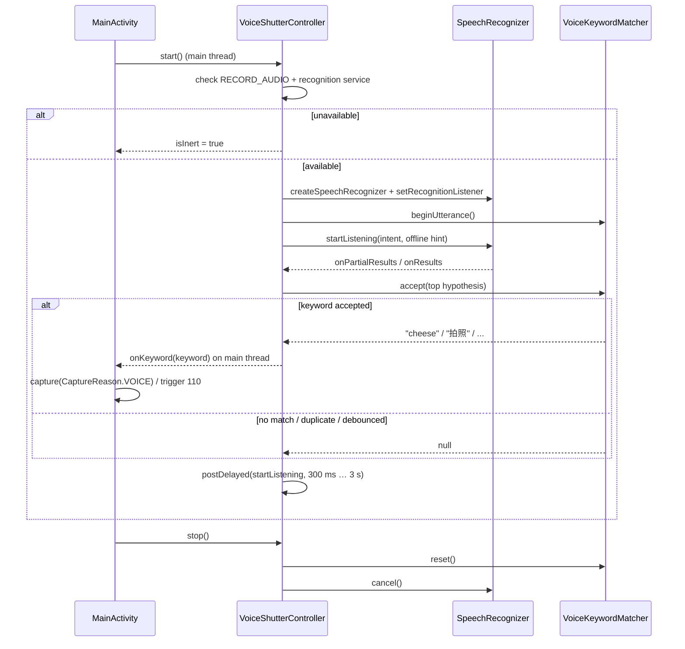
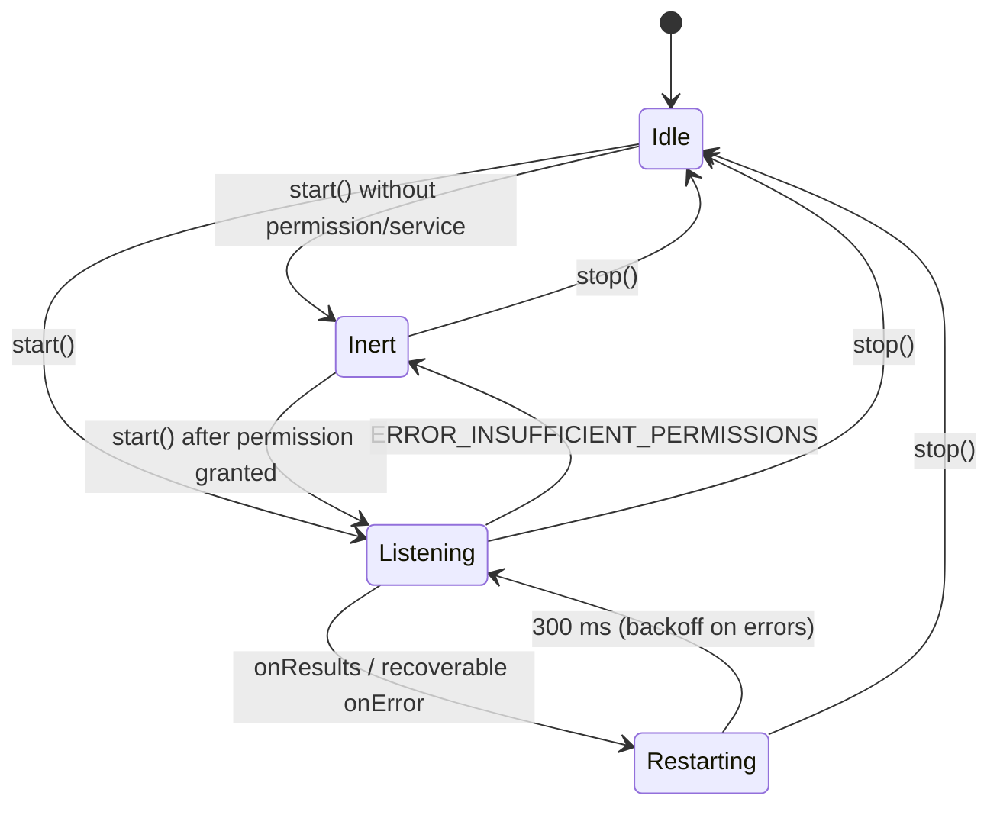

# 02 — Voice shutter

Voice shutter (声控拍照) lets the user take a photo by saying a short phrase. The
stock Poco F4 camera does this with Xiaomi's native always-on wake-word engine
(`libmulti-wakeup-engine.so`), not with `android.speech.SpeechRecognizer`. The
reimplementation substitutes a continuously restarted `SpeechRecognizer` and a
pure-Kotlin phrase matcher.

## Stock architecture

### Components

| Stock component | Path | Role |
|---|---|---|
| `SpeechShutterImpl` | `decompiled2/sources/com/android/camera/module/impl/component/SpeechShutterImpl.java` | Protocol implementation; owns engine lifecycle and converts detections into a broadcast. |
| `SpeechShutterDetect` | `decompiled2/sources/com/android/camera/protocol/protocols/SpeechShutterDetect.java` | Mode-coordinator protocol (`processingSpeechShutter`, `onDestroy`). |
| `MultiWakeupEngine` | `decompiled2/sources/com/xiaomi/asr/engine/MultiWakeupEngine.java` | Static facade over the engine. |
| `MultiWakeupEngineImpl` | `decompiled2/sources/com/xiaomi/asr/engine/impl/MultiWakeupEngineImpl.java` | Threading, handler messages, audio feeding, detection callback. |
| `VoiceRecord` | `decompiled2/sources/com/xiaomi/asr/engine/record/VoiceRecord.java` | `AudioRecord` capture thread. |
| `MultiWakeupEngineInterface` | `decompiled2/sources/com/xiaomi/asr/engine/jni/MultiWakeupEngineInterface.java` | JNI entry points. |
| `libmulti-wakeup-engine.so` | `native/lib/arm64-v8a/libmulti-wakeup-engine.so` (3,508,512 bytes, sha256 `1172043b…10fa0a`) | PaddyMulWakeup/PaddyWakeup model + decoder. |
| `Camera2Module.onBroadcastReceived` | `decompiled2/sources/com/android/camera/module/Camera2Module.java:3457` | Turns the broadcast into a shutter press with trigger mode 110. |

### Lifecycle and state

`SpeechShutterImpl` attaches itself to the mode coordinator
(`registerProtocol`, lines 154–157) and is driven by
`processingSpeechShutter(boolean)` (lines 125–151):

- first enable: `MultiWakeupEngine.setListener(new WVPCallback())` → `init()` →
  `start()` → `mIsInit = true`;
- subsequent enable: `MultiWakeupEngine.restart()` (line 137);
- disable: `MultiWakeupEngine.stop(0)` (line 130);
- `onDestroy` / `unRegisterProtocol`: `MultiWakeupEngine.release()` (lines
  116–122).

`MultiWakeupEngineImpl` serializes all engine work on the
`wakeup-engine-impl-thread` handler thread. Handler messages
(`MultiWakeupEngineImpl.java:46–134`):

| Message | Meaning | Action |
|---|---|---|
| `1` | init | `wakeupInit("")`; `init = wakeupInit == 0`; `onInit(init)` |
| `2` | start capture | `VoiceRecord.startRecord()`; `running = true`; `wakeupReset()` |
| `3` | audio chunk | `wakeupFeedData(chunk, len, 0, info)`; cache chunk |
| `5` | release | stop recording, `wakeupDestroy()`, `init = false`, `onRelease()` |
| `6` | stop capture | stop recording, `running = false` |

`start(int startRecordMs)` removes pending feed/stop messages when
`startRecordMs <= 0`, clears `pause`, then posts message `2` after the delay
(lines 256–264). `stop(long stopRecordMs)` sets `pause = true`, removes pending
feed messages and posts message `6` after the delay (lines 266–271).
`restart()` is `stop(0)` followed by `start(500)` (lines 242–245). The public
facade defaults are `start()` → `start(0)` and `stop()` → `stop(5000)`.

### Audio pipeline

`VoiceRecord` defaults (`VoiceRecord.java:24–28`):

- `mAudioSource = 1` → `MediaRecorder.AudioSource.MIC`;
- `mSampleRate = PcmRecorder.RATE16K = 16000`;
- `mChannels = 16` → `AudioFormat.CHANNEL_IN_MONO`;
- `mAudioEncodingBits = 2` → `AudioFormat.ENCODING_PCM_16BIT`;
- `mRecordBufferSize = 1536`, then overridden in the engine constructor by
  `setParam(2, MediaSessionCompat.MAX_BITMAP_SIZE_IN_DP)` = **320 bytes**
  (`MultiWakeupEngineImpl.java:201–215`; the constant is 320 in
  `decompiled2/sources/android/support/v4/media/session/MediaSessionCompat.java:82`).
  At 16 kHz PCM16, 320 bytes = 160 samples ≈ 10 ms per `AudioRecord.read`.

`AudioRecord.getMinBufferSize(...) * 4` is used as the native buffer size
(`VoiceRecord.java:77–84`). The recording thread raises itself to
`THREAD_PRIORITY_URGENT_AUDIO` (`Process.setThreadPriority(-19)`) and pushes each
read chunk to the engine handler (`VoiceRecord.java:164–185`).

Frame accounting:

- `MultiWakeupEngineImpl.WAKEUP_BUFFER_SIZE = 640`
  (`MultiWakeupEngineImpl.java:23`) is the engine frame size; the JNI layer also
  exposes `wakeupGetFrameSize()`. The engine frame is 640 samples (≈ 40 ms at
  16 kHz). The Java recorder hands the engine 320-byte chunks, so the native
  layer must accumulate them before decoding. `[INFERENCE]` on the exact
  sample-vs-byte unit, which is hidden behind JNI.
- `CircleBuffer(1920000)` (`MultiWakeupEngineImpl.java:213`) is a 1,920,000-byte
  ring ≈ 60 s of 16 kHz/16-bit mono audio. When it fills, the engine calls
  `wakeupReset()`, drains the ring, and delivers the audio via
  `WVPListener.onAudioData` (`MultiWakeupEngineImpl.java:82–94`).

### Wake-word detection and capture path

`wakeupFeedData` writes a `WakeupInfo`; the JNI result levels are
`FEED_RESULT_DETECTED_LEVEL_ONE = 1` (level-one wake-up) and
`FEED_RESULT_DETECTED_END = 2` (final detection), constants at
`MultiWakeupEngineImpl.java:19–20`. Only `wakeupInfo.wakeup == 2` produces a
detection: the engine builds a `PhraseWakeupResult` (`isVoconWakeupPassed =
true`, phrase text) and calls `WVPListener.onPhraseSpotted` (lines 69–80).

`SpeechShutterImpl.WVPCallback.onPhraseSpotted` (lines 84–88) sends:

```java
context.sendBroadcast(new Intent(CameraIntentManager.ACTION_SPEECH_SHUTTER));
```

`ACTION_SPEECH_SHUTTER = "com.android.camera.action.SPEECH_SHUTTER"`
(`CameraIntentManager.java:28`). `Camera2Module.onBroadcastReceived` (lines
3457–3468) rejects the event when `isBlockSnap()`, `isCaptureIntent()`, or a mode
change is in progress, otherwise calls
`onShutterButtonClick(110)`; 110 is
`TriggerConstant.MODE_SPEECH_SHUTTER` (`TriggerConstant.java:21`).

`camera.feature.speechshutter` (`SystemProperties.getBoolean`, line 17) enables
engine debug logging and audio dumping only; it is not the user setting.

### Settings, mode gating, and entry points

- Preference keys: `KEY_SPEECH_SHUTTER = "pref_speech_shutter"` and
  `KEY_SPEECH_SHUTTER_STATUS = "pref_speech_shutter_status"`
  (`CameraSettings.java:407–408`; `DataItemRunning.java:44–45`). The status flag
  is the runtime "engine is running" bit
  (`DataItemRunning.getSpeechShutterRunning` / `setSpeechShutterRunning`,
  `DataItemRunning.java:561–563`, `749–751`).
- `CameraSettings.shouldEnableSpeechShutter(mode)` disables the feature in mode
  `210` and otherwise returns `isSpeechShutterOpen()`, which also requires
  `DataItemRunning.supportSpeechShutter()` (`CameraSettings.java:2859–2864`,
  `3778–3783`, `DataItemRunning.java:777–779`).
- `FragmentBottomAction` calls `processingSpeechShutter(...)` on mode transitions
  (`FragmentBottomAction.java:1191`, `2428`, `2557`); `ConfigChangeImpl` does the
  same when the switch changes (`ConfigChangeImpl.java:4458–4466`).
- The first-run tip string is `speech_shutter_open_tip`
  (`ConfigChangeImpl.java:4157`).

### Localized phrase set

The phrase set is localized only by UI strings; the wake-word model itself is
opaque inside the `.so`.

- English: `Say "Cheese!" to take a photo` —
  `apktool_out/res/values/strings.xml:2494`.
- Chinese: `说出“拍照”或“茄子”即可拍照` —
  `apktool_out/res/values-zh-rCN/strings.xml:1946` (also `values-zh-rHK:1869`,
  `values-zh-rTW:1868`).
- Most other locales keep the English token `Cheese!` (e.g. `values-de`,
  `values-fr`, `values-ja`); only the surrounding translated text changes.
- UI label: `speech_shutter_tip` "Voice shutter" / "声控拍照".

### Manifest

`RECORD_AUDIO` is declared at `apktool_out/AndroidManifest.xml:7`. The
voice-command alias `com.android.camera.VoiceCamera`
(`android.media.action.VOICE_COMMAND`, categories `DEFAULT` + `VOICE`, guarded by
`com.xiaomi.camera.AUX_CONTROL`) is at lines 148–154. It launches the camera for
an external voice assistant; it is independent of the in-app wake-word engine.

## Reimplementation

### Files

| Reimplementation | Purpose |
|---|---|
| `reimpl/app/src/main/java/dev/pocof4/camera/voice/VoiceShutterController.kt` | `Feature` implementation; owns `SpeechRecognizer`, permission/inert handling, restart/backoff, keyword dispatch. |
| `reimpl/app/src/main/java/dev/pocof4/camera/voice/VoiceKeywordMatcher.kt` | Pure-Kotlin phrase normalizer/matcher + debounce/utterance state. No `android.*` imports. |
| `reimpl/app/src/test/java/dev/pocof4/camera/voice/VoiceKeywordMatcherTest.kt` | JVM tests for matching, false positives, debounce, consumption. |
| `reimpl/app/src/main/java/dev/pocof4/camera/MainActivity.kt:100,110–115,143–146` | Constructs the controller, starts/stops it with `AppSettings.voiceShutter`, maps a keyword to `CaptureReason.VOICE` (stock trigger 110). |

### Public API

```kotlin
class VoiceShutterController(context: Context, onKeyword: (String) -> Unit) : Feature
class VoiceKeywordMatcher(
    language: String? = Locale.getDefault().language,
    clock: () -> Long = { System.nanoTime() / 1_000_000L },
    debounceMs: Long = 2500L
)
```

`VoiceShutterController` additionally exposes read-only `isInert` and
`isRunning`, `TAG`, `BASE_RESTART_DELAY_MS` (300 ms) and
`MAX_RESTART_DELAY_MS` (3000 ms). `VoiceKeywordMatcher` exposes `language`,
`phrases`, `match(text)` (stateless), `accept(text)` (stateful),
`beginUtterance()`, `reset()`, `ENGLISH_PHRASES`, `CHINESE_PHRASES`,
`phrasesForLanguage(language)`, and `DEFAULT_DEBOUNCE_MS` (2500 ms).

### Recognition substitute

`VoiceShutterController.start()`:

1. Marshals to the main looper (recognizer creation/start/destroy must happen
   there).
2. Checks `RECORD_AUDIO`; if missing, sets `isInert = true` and returns without
   throwing.
3. Checks `SpeechRecognizer.isRecognitionAvailable(context)`; if no service,
   sets inert and returns.
4. `SpeechRecognizer.createSpeechRecognizer(context)`, installs the
   `RecognitionListener`, sets `isRunning = true`, and calls `startListening`.
5. `startListening` re-arms the matcher for a new utterance and sends
   `ACTION_RECOGNIZE_SPEECH` with:
   `EXTRA_LANGUAGE_MODEL = free_form`, `EXTRA_LANGUAGE`/
   `EXTRA_LANGUAGE_PREFERENCE = Locale.getDefault().toLanguageTag()`,
   `EXTRA_PARTIAL_RESULTS = true`, `EXTRA_PREFER_OFFLINE = true`,
   `EXTRA_MAX_RESULTS = 1`, `EXTRA_CALLING_PACKAGE`.

Every `onResults` and every recoverable `onError` schedules another
`startListening`. Restart delay is 300 ms; consecutive errors use exponential
backoff `300 << n` capped at 3000 ms. After three consecutive errors the
recognizer instance is destroyed and recreated. `ERROR_NO_MATCH` and
`ERROR_SPEECH_TIMEOUT` reset the error count (normal silence).
`ERROR_INSUFFICIENT_PERMISSIONS` marks the controller inert, stops restarting and
releases the recognizer.

`stop()` sets `isRunning = false`, cancels the pending restart, resets the
matcher (including the debounce window), and marshals `cancel()`/`destroy()` to
the main thread. A stop that races a new `start()` does not destroy the new
recognizer (`releaseRecognizer(force = false)` observes `isRunning`), while
`startInternal` force-releases any stale instance.

Only the top recognition hypothesis is inspected. This mirrors the stock
single-detection behavior and avoids firing on a lower-confidence N-best
alternative.

### Required manifest query

Because the app targets API 34, Android 11 package visibility applies to
`SpeechRecognizer` (platform documentation for
[`SpeechRecognizer`](https://developer.android.com/reference/android/speech/SpeechRecognizer)).
The manifest must contain:

```xml
<queries>
    <intent>
        <action android:name="android.speech.RecognitionService" />
    </intent>
</queries>
```

Without it, `SpeechRecognizer.isRecognitionAvailable()` and service binding can
fail, leaving the controller inert. `RECORD_AUDIO` is already declared in
`reimpl/app/src/main/AndroidManifest.xml`; the `<queries>` entry is owned by the
manifest/integration slice.

### Phrase matching

`VoiceKeywordMatcher` normalizes text with:

```text
lowercase(Locale.ROOT) → replace [^\p{L}\p{N}]+ with " " → trim()
```

so case, quotes, punctuation, NBSP and repeated whitespace are irrelevant.
Phrases are tested longest-first.

- English (`zh`-less locales):
  `{"take a photo", "capture", "cheese", "photo", "shoot"}`.
  Latin phrases require non-letter/digit boundaries before and after:
  `Say "Cheese!"` and `say cheese please` match `cheese`; `cheesecake`,
  `cheeseburger`, `photograph`, `photosynthesis`, `shooting` and `captured` do
  not. `cheese` does not match inside Chinese text and vice versa.
- Chinese (`language.startsWith("zh")`):
  `{"拍张照", "拍照", "茄子", "照相"}`. Chinese has no word delimiters, so these
  are substring matches: `我要拍照了` and `请帮我拍张照吧` trigger; `吃饭` and
  `番茄` do not.

`accept(text)` adds runtime semantics:

- at most one keyword per utterance (`utteranceConsumed`), even if later
  partial/final hypotheses contain another phrase;
- no keyword within 2500 ms of the previous accepted keyword;
- `beginUtterance()` (called for each new recognition session) re-arms the
  per-utterance gate but preserves the debounce timestamp;
- `reset()` (called from `stop()`) clears both.

### Runtime flow



### State machine



### Stock → reimplementation mapping

| Stock | Reimplementation |
|---|---|
| `SpeechShutterImpl.processingSpeechShutter` | `VoiceShutterController.start()` / `stop()` |
| `MultiWakeupEngine.init/start/restart/release` | recognizer creation + restart loop + destroy |
| `MultiWakeupEngine.stop(0)` / `stop(5000)` | `stop()` (immediate cancel) |
| `VoiceRecord` 16 kHz mono PCM16 `AudioRecord` | Android speech service owns capture; no direct `AudioRecord` |
| `wakeupFeedData` + `WakeupInfo.wakeup == 2` | `RecognitionListener` hypotheses + `VoiceKeywordMatcher.accept` |
| Native grammar ("Cheese!" / 拍照 / 茄子) | `ENGLISH_PHRASES` / `CHINESE_PHRASES` |
| `ACTION_SPEECH_SHUTTER` broadcast | direct `onKeyword(String)` callback |
| `Camera2Module.onShutterButtonClick(110)` | `MainActivity.onVoiceKeyword` → `capture(CaptureReason.VOICE)` (`stockTriggerMode = 110`) |
| `pref_speech_shutter` / `pref_speech_shutter_status` | `AppSettings.voiceShutter` / `KEY_VOICE = "pref_speech_shutter"` |
| mode-210 exclusion (`shouldEnableSpeechShutter`) | not modelled; the reimplementation is a single-mode app |
| `libmulti-wakeup-engine.so` | not shipped; no JNI dependency |

## Deviations and limitations

- **No true always-on keyword spotter.** `SpeechRecognizer` streams audio to a
  recognition service and is session-based. Continuous restart adds gaps
  (≥ 300 ms plus service setup), so a phrase spoken entirely during a gap is
  missed. The native engine decodes a continuous stream of frames with no
  session gap.
- **Battery and bandwidth.** Keeping recognition active holds the microphone and
  wakes the recognition provider repeatedly. The stock implementation is a
  low-power DSP/model path. The reimplementation is intended for short sessions.
- **Offline pack dependency.** `EXTRA_PREFER_OFFLINE` is a hint. If the locale's
  offline model is not downloaded, providers may use the network or fail with
  `ERROR_NETWORK*`; the controller backs off and retries but cannot make the
  provider work offline.
- **Latency and word-level accuracy.** Recognition adds hundreds of
  milliseconds and may normalize spoken phrases differently (e.g. "take a
  photo" vs "take a photo."). The matcher is tolerant but not a phonetic
  matcher. `[INFERENCE]` the stock engine detects the acoustic phrase directly
  and does not depend on an ASR transcript.
- **False positives.** Because recognition is free-form, common words are
  guarded only by boundaries and the phrase list. Chinese has no word
  boundaries, so a substring such as `照相馆` (photo studio) also contains
  `照相` and would trigger. The 2.5 s debounce and one-trigger-per-utterance rule
  reduce double captures but do not add acoustic confidence scoring; no
  equivalent of the stock wake-word score exists.
- **No AEC / concurrent audio.** The controller does not request audio focus or
  use `AudioRecord` directly, so it cannot coexist reliably with video recording
  or other microphone consumers. The stock `VoiceRecord` has the same
  single-mic constraint but runs in the camera process.
- **Locale handling is binary.** Only `zh*` selects Chinese; every other locale
  uses the English set, matching the requirement and the fact that most
  translated `speech_shutter_open_tip` strings retain `Cheese!`.
- **No broadcast surface.** Only the in-app callback is provided; the stock
  `com.android.camera.action.SPEECH_SHUTTER` broadcast and the
  `com.android.camera.VoiceCamera` alias are not exposed.
- **Mode gating.** The reimplementation has one camera mode, so the stock
  mode-210 rule and per-mode toggling are not reproduced.

## Verification

JVM unit tests (no device needed):

```bash
./gradlew :app:testDebugUnitTest --tests 'dev.pocof4.camera.voice.*'
```

`VoiceKeywordMatcherTest` asserts: exact words; mixed case; punctuation/quotes/
NBSP; trailing words; longest-phrase selection; word-boundary rejection of
`cheesecake` / `photograph` / `captured`; partial-word rejection; empty/null
input; Chinese substring matching and fullwidth punctuation; cross-language
rejection; 2.5 s debounce boundary; one trigger per utterance; `beginUtterance`
re-arm; `reset`; and that non-matching results neither consume the utterance nor
arm the debounce.

On device:

1. Grant microphone permission, enable "Voice shutter" in settings
   (`pref_speech_shutter`), and keep the app in the foreground.
2. Say "cheese" or "take a photo" (English locale) or "拍照"/"茄子" (Chinese
   locale); the status line shows `Voice shutter: "<keyword>"` and a capture is
   triggered with `CaptureReason.VOICE`.
3. Say "cheesecake" or "photograph"; no capture should occur.
4. Say "cheese" twice within 2.5 s; only one capture should occur.
5. Deny `RECORD_AUDIO` and restart the feature; no crash, and
   `VoiceShutterController.isInert` is true.
6. Disable the feature while listening; the microphone indicator must disappear
   (recognizer destroyed) and no further callbacks occur.
