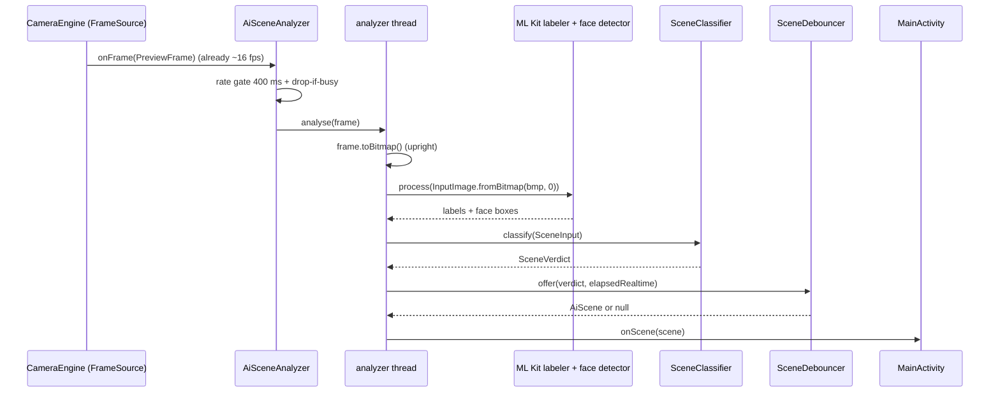
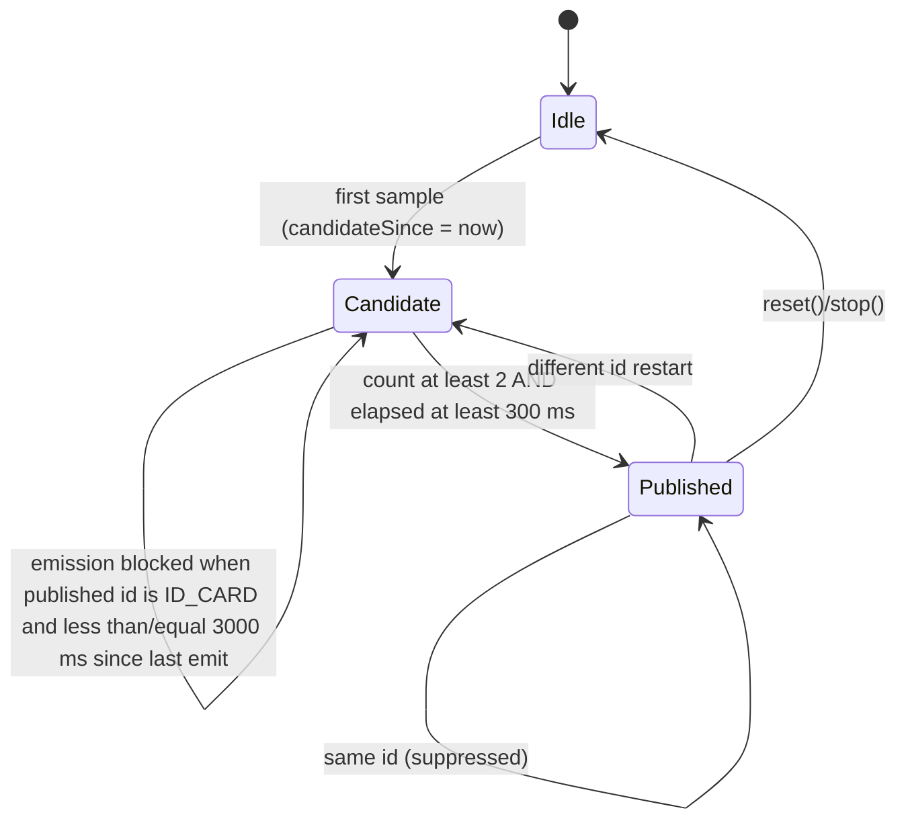

# 03 — AI features: scene detection, beauty, watermark

Package: `dev.pocof4.camera.ai`
Stock reference: MiuiCamera 5.1.001140.0 (Poco F4 dump), decompiled at `decompiled2/sources`.

Scope:

| Feature | Stock mechanism | Reimplementation |
|---|---|---|
| AI scene detection (ASD) | Camera HAL vendor tag `AI_SCENE_DETECTED` consumed by a Camera2 interceptor | On-device ML Kit labelling + face detection + luminance heuristics, mapped onto the stock id space |
| AI beauty | Vendor capture-request tags rendered by `libCameraEffectJNI.so` | ML Kit face detection, YCbCr skin mask, box-blur guided smoothing, slight brightening |
| AI watermark | Scene id → watermark key → Xiaomi PNG overlay | Text badge / timestamp / device line drawn with `Canvas` |

Everything that is pure logic (classifier, debouncer, luma, mask, box blur, blend) lives in classes with no `android.*` imports and is covered by JVM JUnit tests.

---

## 1. AI scene detection (ASD)

### 1.1 Stock architecture

The stock app never computes scenes in Java. The camera HAL writes an integer scene id into the vendor capture-result key `AI_SCENE_DETECTED` (`decompiled2/sources/com/android/camera2/vendortag/CaptureResultVendorTags.java:398`) and `com.android.camera.module.interceptor.camera.AiSceneMultipleASD` filters/forwards it.

* `AiSceneMultipleASD` (`decompiled2/sources/com/android/camera/module/interceptor/camera/AiSceneMultipleASD.java`)
  * `initAndGetPriorCondition` (lines 186–193): requires the per-device vendor capability (`OooO00o...o00Oo000()`), records `activeRegion = getActiveArraySize(capabilities)` and `mIsFrontCamera = CameraSettings.isFrontCamera()`.
  * `declareTags` (78–84): subscribes to `SCALER_CROP_REGION`, `STATISTICS_FACES`, `AI_HDR_DETECTED`, `AI_SCENE_DETECTED`.
  * `getSampleTime() == 0`, `getScope() == 6`, `moveOnMainThread() == true`: evaluated for every capture result and delivered on the main thread.
  * `acceptResult` (119–162):
    * `fWidth = activeRegion.width / cropRegion.width`.
    * Front camera or no faces ⇒ candidate face-scene value is `Integer.MIN_VALUE` (127).
    * Otherwise any `face.getBounds().width() > 300.0f / fWidth` ⇒ candidate `25` (HUMAN) (132–135). Because crop and active regions scale together, this is equivalent to **face box wider than ~7.5 % of the cropped frame**.
    * `faceSceneFiltering(candidate)` (35–56) must return true before the parsed scene can change: the same candidate has to be observed on 20 consecutive capture results; the filter then fires exactly once per 20 stable frames. `mCurrentFaceScene` is never assigned in this decompilation, so the comparison at line 46 effectively compares against 0 ([INFERENCE] this is either a decompilation artifact or a harmless stock bug; the observable cadence is one promotion per 20 stable frames).
    * When the filter fires: if the candidate is `MIN_VALUE` or the vendor scene is `38` (ID_CARD), the vendor `sceneResult` is used; negatives are coerced to 0 (145–151). Otherwise the face result (`25`) wins (153).
    * Moon is rejected when the device does not advertise super-moon support: `!o00oOo00() && sceneResult == 35` ⇒ `sceneResult = 0` (140–143).
    * Module index 186 (super-moon module) suppresses ids 10 and 35 (155–159).
  * `dataChanged` (57–76): change throttle. If the current scene is ID_CARD (38) and the parsed scene differs, the change is rejected unless **more than 3000 ms** elapsed since the previous change. Otherwise changes are rejected when the id is unchanged or less than **300 ms** elapsed.
  * `consumeResultOnMainThreadIfDataChanged` (164–172): pushes `mCurrentDetectedScene` to `Camera2Module.mAiSceneMgr.consumeAiSceneResult(...)` when `dataChanged()` or the AI-scene preference toggled.
  * `getInTimeCondition` (173–183): disabled (`resetScene()`) when `mAiSceneEnabled` is false or while a repeating request / action is in progress.
* `com.android.camera.module.image.AiSceneManager` (`decompiled2/sources/com/android/camera/module/image/AiSceneManager.java`)
  * `consumeAiSceneResult` (245–256) forwards to `realConsumeAiSceneResult` unless the module is gone or ASD is disabled, then updates preferences on the work thread.
  * `realConsumeAiSceneResult` (60+) applies scene-specific behaviour: `1` DOC boosts sharpness, `10` NIGHT forces flash off / MFNR / OIS refresh, `4` PPT sets contrast and re-trampolines preferences, `7`/`8` restore mutex elements, `25` HUMAN enables AI30 (back camera only).
  * UI tips are limited to DOC, PPT and ID_CARD: `AiSceneModeConstant.isPopTipRequired` (`decompiled2/sources/com/android/camera/constant/AiSceneModeConstant.java:55-57`) gates `FragmentBottomPopupTips` (lines 890, 1165) and `FragmentTopConfig` (2930).
* Legacy / MiAlgo paths in this dump are stubs:
  * `module/loader/FunctionAsdSceneDetect.java` always returns `-3`, `getLowLightValue()` returns 0, `getFlashScene()` returns -1.
  * `module/loader/tempfunction/FunctionParseAiScene.java` always returns 0.
  * `scene/FunctionMiAlgoASDEngine.java` is a pass-through; `MI_ALGO_ASD_SCENE` system property enables its logging.
  * `scene/MiAlgoAsdSceneProfile.java` defines the MiAlgo type space: `NONE=0`, `NON_SEMANTIC_CLASS=1`, `STATE_CLASS=2`, `AI_SCENE_DETECTED=3`, `ON_TRIPOD=4`, `DIRTY=6`, `HDR=8`, `AI_SCENE_SHIFT=1000`, versions 2.0/3.0, `COMPAT_FOOD = 3|1000 = 1003`.
  * `constant/AsdSceneConstant.java` holds the unrelated legacy scene results (`SCENE_INVALID=-3`, `SCENE_NONE=-1`, `SCENE_NIGHT=2`, ...); `scene/AsdConstants.java` only defines `ASD_SUPER_NIGHT_ENABLE/DISABLE`.

Settings:

* `CameraSettings.KEY_AI_SCENE_MODE = "pref_camera_ai_scene_mode_key"` (`CameraSettings.java:99`).
* `CameraSettings.KEY_RETAIN_AI_SCENE = "pref_retain_ai_scene_key"`, default `true` (395, 3294).
* `CameraSettings.getAiSceneOpen(module)` returns `false` when beauty-lens mode is active, otherwise the per-module `ComponentConfigAi` value (602–607).
* Hint text: `ai_scene_mode_use_hint_text` = "Recognize scenes using AI\nand adjust preferences automatically" (`apktool_out/res/values/strings.xml:297`).

#### Control flow

```mermaid
sequenceDiagram
    participant HAL as Camera HAL
    participant Chain as ASDInterceptorChain
    participant ASD as AiSceneMultipleASD
    participant Mgr as AiSceneManager
    participant UI as TopAlert / tips
    HAL->>Chain: CaptureResult(AI_SCENE_DETECTED, FACES, CROP_REGION)
    Chain->>ASD: acceptResult()
    ASD->>ASD: active/crop ratio; face width > 300px ? candidate=25 : MIN_VALUE
    ASD->>ASD: faceSceneFiltering: same candidate x20
    alt filter fired
        ASD->>ASD: vendor scene (moon check), else 25
    end
    ASD->>ASD: dataChanged: 300 ms throttle, 3 s after ID_CARD
    ASD->>Mgr: consumeAiSceneResult(scene)
    Mgr->>Mgr: per-id effects (sharpness, flash, MFNR, contrast...)
    Mgr->>UI: tip for DOC / PPT / ID_CARD
```

### 1.2 Id space

`AiSceneModeConstant` defines **40 named constants in a 46-slot id space**; ids 23, 24 and 39–43 have no constant. The `ai_scene_res` label array (`apktool_out/res/values/arrays.xml:168-210`) has 42 entries and is positional only up to id 38; it contains Backlight at index 23 and Silhouette at index 24, and the labels for monkey/palm/three-wheeler sit at array indices 39–41 although their ids are 44–46.

| id | constant | English label (strings.xml) | Stock watermark key (`ASDEngine`) |
|---:|---|---|---|
| 0 | UNKNOWN | Unknown | `negative` |
| 1 | DOC | Document | `negative` |
| 2 | FLOWER | Flowers | `flower` |
| 3 | FOOD | Food | `delicacy` |
| 4 | PPT | Presentation | `negative` |
| 5 | SKY | Sky | `bluesky` |
| 6 | SUNRISE_SUNSET | Sunrises and sunsets | `sunrise_sunset` |
| 7 | CAT | Cats | `cat` |
| 8 | DOG | Dogs | `dog` |
| 9 | GREEN_PLANTS | Plants | `plants` |
| 10 | NIGHT | Night | `nightscape` |
| 11 | SNOW | Snow | `negative` |
| 12 | SEA | Seaside | `negative` |
| 13 | AUTUMN | Autumn | `negative` |
| 14 | CANDLE_NIGHT | Candlelight | `negative` |
| 15 | CAR | Cars | `negative` |
| 16 | GRASS | Grass | `grassplot` |
| 17 | MAPLE_LEAVES | Leaves | `leafs` |
| 18 | SUCCULENT | Succulent plants | `fleshiness` |
| 19 | BUILDING | Architecture | `negative` |
| 20 | CITY | City | `negative` |
| 21 | CLOUD | Clouds | `cloudy` |
| 22 | OVERCAST | Overcast | `overcast` |
| 23 | *(reserved)* | Backlight (array only) | — |
| 24 | *(reserved)* | Silhouette (array only) | — |
| 25 | HUMAN | Person | `negative` |
| 26 | JEWELRY | Jewelry | `negative` |
| 27 | BUDDHA | Statue | `buddha` |
| 28 | COW | Cows | `cow` |
| 29 | CURRY | Curry | `negative` |
| 30 | MOTORBIKE | Motorcycles | `motorcycle` |
| 31 | TEMPLE | Temple | `negative` |
| 32 | BEACH | Beach | `negative` |
| 33 | DRIVING | Underwater (stock string quirk) | `underwater` |
| 34 | TOWER | Tower | `negative` |
| 35 | MOON | Moon | `negative` |
| 36 | SIDEFACE | Group photo | `negative` |
| 37 | SCULPTURE | Sculpture | `negative` |
| 38 | ID_CARD | ID | `negative` |
| 44 | MONKEY | Monkeys | `monkey` |
| 45 | COCONUT_TREE | Palm trees | `coconut_tree` |
| 46 | TUTUK | Three-wheeler | `tutuk` |
| -2 | UNSPECIFIED | — | — |

`isPopTipRequired(id)` is true only for DOC (1), PPT (4) and ID_CARD (38), and only in camera modules (`AiSceneModeConstant.java:55-57`).

### 1.3 Reimplementation

Files:

* `ai/AiSceneAnalyzer.kt` — `class AiSceneAnalyzer(context, frameSource, onScene) : FrameListener, Feature`.
* `ai/SceneClassifier.kt` — pure classifier (`SceneInput`, `SceneVerdict`, `LabelScore`).
* `ai/SceneDebouncer.kt` — stability + stock throttles.
* `ai/LumaStats.kt` — Rec.601 luma and top/bottom third means.
* `ai/SceneLabels.kt` — English label table (with the "Underwater" quirk preserved).

Data flow:



Implementation details:

* Frames arrive on the CameraEngine analysis thread. `onFrame` only checks `started`, the 400 ms rate gate and a `pending` flag, then hands the frame to a dedicated single-thread executor. While ML Kit is busy, frames are dropped, never queued.
* `PreviewFrame.toBitmap()` (shared helper in `camera/FrameBitmap.kt`) produces an upright ARGB bitmap; the `PreviewFrame.rotationDegrees` therefore does **not** need to be passed to `InputImage` (passing it would rotate twice).
* ML Kit clients: bundled `ImageLabeling` with confidence threshold 0.4 (the classifier applies the real per-label thresholds) and `FaceDetection` in `PERFORMANCE_MODE_FAST` with `setMinFaceSize(0.05f)`.
* Both tasks run in parallel (`Tasks.whenAllComplete`); the completion listener runs on the analyzer executor. A task failure degrades to an empty result instead of killing the pipeline.
* Luma statistics are computed from the upright bitmap with the same integer weights as the preview packer: `(77R + 151G + 28B) >> 8`.
* Face width ratio = widest ML Kit face box / bitmap width. The stock 300 px rule becomes `HUMAN_FACE_WIDTH_RATIO = 0.075`.
* `isFrontCamera` must be set by the host; front-camera frames never report HUMAN, exactly like `AiSceneMultipleASD` line 127. (The current `CameraEngine` binds the back camera only.)
* `stop()` removes the listener, increments a generation counter, clears the debouncer and closes both ML Kit clients. `start()` recreates them, so the feature can be toggled repeatedly.
* Callback: `onScene(AiScene)` is invoked on the analyzer thread; `MainActivity` marshals to the UI thread itself.

#### Classifier priority table

`SceneClassifier.classify` evaluates top-down and returns the first match. ML Kit label names are lower-cased, trimmed, `_` → space and whitespace-collapsed; a label text may match several rules, the highest confidence wins within a rule. Generic threshold: 0.55–0.60; "strong" document 0.75. Ids 23/24 are never emitted.

| # | Output id | Condition |
|---:|---|---|
| 1 | MOON (35) | moon family ≥ 0.50 |
| 2 | CANDLE_NIGHT (14) | candle/flame/fire ≥ 0.60 and mean luma < 90 |
| 3 | ID_CARD (38) | id-document family ≥ 0.50, **or** document ≥ 0.75 + 1.25 ≤ aspect ≤ 1.85 + mean luma ≥ 150 + presentation < 0.50 |
| 4 | PPT (4) | presentation/projector/whiteboard/screen ≥ 0.60 |
| 5 | DOC (1) | document/paper/text/book ≥ 0.60 |
| 6 | CURRY (29) | curry/stew/soup ≥ 0.60 |
| 7 | FOOD (3) | food/dish/cuisine/dessert/... ≥ 0.55 |
| 8 | SUNRISE_SUNSET (6) | sunset/sunrise/dusk/dawn ≥ 0.60 |
| 9 | NIGHT (10) | night label ≥ 0.50 and mean luma < 90, **or** mean luma < 45 |
| 10 | SNOW (11) | snow/winter/ice ≥ 0.60 |
| 11 | SEA (12) | sea/ocean/coast/wave ≥ 0.60 |
| 12 | BEACH (32) | beach/sand/seaside ≥ 0.60 |
| 13 | SKY (5) | sky/blue sky/horizon ≥ 0.55 |
| 14 | CLOUD (21) | cloud(s) ≥ 0.60 |
| 15 | OVERCAST (22) | overcast/rain/fog/storm ≥ 0.60 |
| 16 | FLOWER (2) | flower/blossom/rose ≥ 0.55 |
| 17 | SUCCULENT (18) | succulent/cactus/aloe ≥ 0.55 |
| 18 | GRASS (16) | grass/lawn/meadow ≥ 0.60 |
| 19 | MAPLE_LEAVES (17) | leaf/leaves/maple/foliage ≥ 0.55 |
| 20 | GREEN_PLANTS (9) | plant/tree/vegetation/garden ≥ 0.55 |
| 21 | CAT/DOG/COW/MONKEY (7/8/28/44) | cat, dog, cow, monkey families ≥ 0.60 |
| 22 | BUILDING/CITY/TOWER/TEMPLE/BUDDHA/SCULPTURE/CAR/MOTORBIKE (19/20/34/31/27/37/15/30) | per-label sets ≥ 0.55–0.60 |
| 23 | HUMAN (25) | back camera and face width ratio ≥ 0.075 |
| 24 | UNKNOWN (0) | otherwise; backlit frames without a usable face also land here |

Notes:

* NIGHT is checked before SKY, so a dark sky is reported as night; FOOD/CURRY/DOC are checked before NIGHT so a dark restaurant/table shot keeps its subject.
* Backlight is detected as `topLuma / bottomLuma ≥ 2.2` (`SceneInput.isBacklit`). Because the id space has no constant for Backlight (23) or Silhouette (24), the reimplementation maps a backlit frame to HUMAN when a wide face is present and to UNKNOWN otherwise. It never invents an id.
* Confidence in `AiScene` is the winning label confidence, or 1.0 for luma/face rules. UNKNOWN carries 0.

#### Debounce / throttle state machine



`SceneDebouncer.offer(verdict, nowMs)` returns `null` unless the verdict is new and stable. It reproduces:

| Rule | Source |
|---|---|
| stable for ≥ 2 consecutive analyses | replacement for the stock 20-frame face confirmation, which would cost ~8 s at 2.5 analyses/s |
| ≥ 300 ms since first observation | `AiSceneMultipleASD.dataChanged()` 300 ms change throttle |
| repeating the published id is suppressed | `mCurrentDetectedScene == parsed` check |
| leaving ID_CARD requires > 3000 ms since the last publication | `AiSceneMultipleASD.dataChanged()` ID-card branch |

UNKNOWN is debounced like any other id, so a lost scene clears the UI after the same stability window. Entering ID_CARD is not delayed; only leaving it is throttled, matching the stock condition.

### 1.4 Vendor / hardware-bound parts

* `AI_SCENE_DETECTED` is a HAL vendor tag (`CaptureResultVendorTags.java:398`); it is absent on CameraX/legacy devices, which is why the whole stock path cannot be reused.
* Moon support (`o00oOo00()`), AI30 support, super-moon module (index 186), per-module capability flags and the 46-class neural model are vendor/device specific.
* The stock label array drifts from the constant ids and watermark keys differ per region; the reimplementation follows the constants (which are what the UI receives).

---

## 2. AI beauty

### 2.1 Stock architecture

* Preference keys (`CameraSettings.java`):
  * `KEY_FACE_BEAUTY_ADVANCED = "pref_camera_face_beauty_advanced_key"` (261)
  * `KEY_FACE_BEAUTY_SWITCH = "pref_camera_old_face_beauty_switch_key"` (262)
  * `KEY_BEAUTIFY_SKIN_SMOOTH_RATIO = "pref_beautify_skin_smooth_ratio_key"` (142)
  * `KEY_BEAUTIFY_SKIN_COLOR_RATIO = "pref_beautify_skin_color_ratio_key"` (141)
  * `KEY_BEAUTIFY_WHITEN_RATIO = "pref_beautify_whiten_ratio_key"` (148)
  * plus slim-face / enlarge-eye / makeup keys (121, 1841–1842).
* Parameters are collected into `BeautyValues` (`fragment/beauty/BeautyValues.java`: `mBeautySkinSmooth`, `mBeautySkinColor`, `mBeautyWhiten`, `mBeautySlimFace`, `mBeautyEnlargeEye`, ...) and driven by `BeautySettingManager` / `BeautySettingBusiness` / `BeautyPortraitParamsFragment`; `MiNightParamsFragment` only overrides the shine type to `"11"`.
* Values are published as Camera2 vendor capture-request tags through `BeautyConstant.BEAUTY_VENDOR_TAG_MAP` (`constant/BeautyConstant.java:59,144-182`, e.g. `BEAUTY_MODE`).
* The actual effect chain is native: `com.android.camera.effect.ShaderNativeUtil` loads `libCameraEffectJNI.so` (`effect/ShaderNativeUtil.java:12`) and exposes `genWaterMarkRange`, `mergeWaterMarkRange`, `getJpegPicture`, `parseYUVImage`, ... The .so ships for arm64-v8a at `native/lib/arm64-v8a/libCameraEffectJNI.so`.
* AI scene and beauty are mutually exclusive: `getAiSceneOpen` returns false when beauty lens is on (`CameraSettings.java:602-607`).

### 2.2 Reimplementation

`AiBeauty.apply(bitmap, strength)` (blocking, call off the main thread):

1. Clamp `strength` to 0..1; copy the source to a mutable `ARGB_8888` bitmap (also converts hardware bitmaps).
2. Detect faces with ML Kit `FaceDetection` (`PERFORMANCE_MODE_FAST`, min face size 0.05) and await the task with a 2.5 s timeout. Detection failures are treated as "no faces".
3. If zero faces, or `strength == 0`, return the copy unchanged.
4. Convert each face box to `FaceOval(centerX, centerY, halfWidth, halfHeight)`.
5. Build the soft mask (`SkinMask`): `skinScore × ellipseWeight`, max over faces.
   * YCbCr membership: Y 35..60 / 245..255 ramps, Cb 68..80 / 124..134 trapezoid, Cr 133..138 / 168..176 trapezoid. Product of the three weights, so grey/white/blue/green pixels score 0.
   * Ellipse: weight 1 inside the face ellipse, linear feather to 0 at 1.4× radius. Pixels outside all ellipses stay 0.
6. Smooth and brighten (`BeautyProcessor`), no RenderScript:
   * Radius = `clamp(min(width, height) / 120, 2, 8)`.
   * Separable box blur (`BoxBlur`, running sums, border-clipped windows) on R, G, B and luma.
   * Edge stop: `1 / (1 + (|luma − blurredLuma| / 12)^2)`.
   * `alpha = mask × strength × edgeStop`, `boost = 10 × strength × mask × edgeStop`.
   * `out = src + (blurred − src) × alpha + boost` per channel, alpha byte preserved.
   * Pixels with mask 0 are copied byte-for-byte.
7. Return a new bitmap; the input bitmap is never modified.

Limitations: only smoothing + brightening are reproduced. Slim face, eye enlargement, makeup, skin tone, hairline, body reshaping and the night/ambient-lighting profiles are vendor effects with no equivalent here. `strength` is a single scalar; the app currently calls `AiBeauty.apply(output, 0.6f)` after any HDR/night fusion and before the watermark.

---

## 3. AI watermark

### 3.1 Stock architecture

* `aiwatermark/handler/ASDHandler.java`
  * Constructor stores the current scene (`mSpots`) and an `ASDWatermark` data source (lines 27–34).
  * `createASDListner()` (36–53) registers an `IASDListener` on `AIWatermarkDetect`; `onASDChange(spots)` compares old/new keys and reloads the watermark.
  * `findWatermark()` (79–98): `ASDEngine.spots2ASDKey(mSpots)` → first `WatermarkItem` whose key matches → `updateWatermark()` via `AIWaterMarkProtocol.updateWatermarkSample`.
* `aiwatermark/algo/ASDEngine.java:9-38`: `SparseArray<Integer → String>` mapping scene ids to `WatermarkConstant` keys; unknown ids fall back to `ASD_NEGATIVE` (`"negative"`).
* `aiwatermark/data/ASDWatermark.java:7-15`: `getForAI()` = watermark type 7, `getForManual()` = type 3; the list of `WatermarkItem`s comes from `AbstractWatermarkData.getWatermarkByType`.
* `aiwatermark/fragment/aiwatermark/FragmentASDWatermark.java` selects/updates the overlay in the UI.
* Watermark compositing is native: `ShaderNativeUtil.genWaterMarkRange*`, `mergeWaterMarkRange*`, `getWaterMarkRange*` (`effect/ShaderNativeUtil.java:30-58`).
* Scene → key mapping (verbatim from `ASDEngine`): 0→negative, 2→flower, 18→fleshiness, 17→leafs, 16→grassplot, 9→plants, 28→cow, 8→dog, 7→cat, 5→bluesky, 22→overcast, 21→cloudy, 3→delicacy, 27→buddha, 30→motorcycle, 6→sunrise_sunset, 10→nightscape, 33→underwater, 44→monkey, 45→coconut_tree, 46→tutuk. Everything else → negative.

### 3.2 Reimplementation

`WatermarkRenderer.render(bitmap, scene, timestampMs)`:

* Copies to a mutable `ARGB_8888` bitmap and draws with `Canvas`.
* Scale factor `width / 1080`, clamped 0.55..2.5; margin = max(3.5 % of width, 12 × scale). All text is clamped to the available width.
* Bottom-left stack, drawn bottom-up:
  1. device line `POCO F4` (22 × scale, regular).
  2. timestamp `yyyy.MM.dd  HH:mm` from `timestampMs` (20 × scale, regular).
  3. if `scene != null && scene.isKnown`: rounded badge `AI SCENE  <LABEL>` in upper case (30 × scale, bold) on a 25 % black rounded rectangle.
* Text is near-white (`0xF2FFFFFF`) with a soft shadow (`setShadowLayer`, `0x99000000`), so it stays legible on both bright and dark photos. The bitmap's alpha is preserved by drawing onto the copy.
* Output is a new bitmap; the input is untouched.

Limitations: the stock PNG artwork and the vendor compositor are unavailable, so this is a text watermark rather than Xiaomi's graphic scene stamps. The badge shows the reimplementation's scene label rather than selecting a stock `WatermarkItem`; unknown scenes still get timestamp + device line.

---

## 4. Mapping table

| Stock component | Reimplementation |
|---|---|
| `constant/AiSceneModeConstant` (ids, `isPopTipRequired`) | `core/AiScene.kt` (`AiSceneIds`), `ai/SceneLabels.kt` |
| `module/interceptor/camera/AiSceneMultipleASD` (face rule, 20-frame filter, 300 ms / 3 s throttles, front suppression) | `ai/SceneClassifier` (face ratio + front flag), `ai/SceneDebouncer`, `ai/AiSceneAnalyzer` |
| `CaptureResultVendorTags.AI_SCENE_DETECTED` | ML Kit `ImageLabeling` + `FaceDetection` over `PreviewFrame` |
| `module/image/AiSceneManager` (per-scene effects) | not reproduced; `MainActivity.renderScene` only shows a chip |
| `module/loader/FunctionAsdSceneDetect`, `MiAlgoAsdSceneProfile` (legacy stub) | `ai/SceneClassifier` rules + `ai/LumaStats` |
| `aiwatermark/algo/ASDEngine` (id → key) | `ai/SceneLabels` label + `ai/WatermarkRenderer` |
| `aiwatermark/handler/ASDHandler`, `ASDWatermark`, `FragmentASDWatermark` | `ai/WatermarkRenderer.render` |
| `ShaderNativeUtil` watermark natives | Canvas text rendering |
| `BeautyValues` / `BeautySettingManager` / beauty fragments | `AppSettings.aiBeauty` toggle; fixed strength 0.6 from `MainActivity` |
| `BeautyConstant.BEAUTY_VENDOR_TAG_MAP` + `libCameraEffectJNI.so` | `ai/AiBeauty` + `ai/SkinMask` + `ai/BeautyProcessor` + `ai/BoxBlur` |

Reimplementation preference keys (`core/AppSettings.kt`): `aiScene` → `pref_camera_ai_scene_mode_key` (stock key), `aiBeauty` → `pref_camera_face_beauty_advanced_key` (stock key), `aiWatermark` → `pref_ai_watermark` (a reimplementation-only key; the stock dump has no single AI-watermark boolean, only per-mode keys such as `pref_camera_flashmode_ai_watermark_key` at `CameraSettings.java:272`).

---

## 5. Verification

### JVM unit tests (`reimpl/app/src/test/java/dev/pocof4/camera/ai`)

| Test | Asserts |
|---|---|
| `SceneClassifierTest` | every priority branch, label normalization, confidence gates, night luma, ID-card aspect/luma heuristic, HUMAN 7.5 % threshold, front-camera suppression, backlight never emits ids 23/24, ratio math |
| `SceneDebouncerTest` | 2-sample + 300 ms stability, repeat suppression, flicker rejection, scene change, 3 s ID-card exit throttle, ID-card entry not delayed, reset |
| `LumaStatsTest` | Rec.601 weights match the preview packer, top/bottom thirds, uniform and empty frames |
| `SkinMaskTest` | skin tones pass, grey/white/blue/green rejected, ellipse containment, 1.4× feather, empty faces, degenerate ellipses |
| `BoxBlurTest` | uniformly flat input, zero radius, impulse spread, border clipping |
| `BeautyProcessorTest` | zero mask/strength identity, brightening amount, strength scaling, hard-edge preservation, alpha preservation, clamping |

Run with `./gradlew :app:testDebugUnitTest --tests 'dev.pocof4.camera.ai.*'` (the coordinator runs the build; these tests are JVM-only and import no Android classes).

### On-device checks

1. Toggle "AI scene detection" in the settings dialog. Point the camera at a document/screen, a face filling ~10 % of the width, a dark room, a sky. The `sceneChip` must appear only after the scene is stable for two analyses and disappear when the scene is lost; it must not flicker on a moving subject.
2. Cover the lens / enter a dark room: NIGHT (10). Front camera: PERSON (25) must never appear.
3. Toggle "AI beauty", capture a portrait: skin is smoothed and slightly brighter; eyes, nostrils, hair and background keep their detail; a photo without faces is returned unchanged. No RenderScript is used.
4. Toggle "AI watermark", capture: bottom-left shows the device line, timestamp and (if a scene was detected) the `AI SCENE …` badge; text scales on 12 MP and low-resolution captures and stays inside the margins.
5. Toggle AI scene off/on repeatedly: no ML Kit leak, no duplicate callbacks (start/stop recreate and close the detectors).
