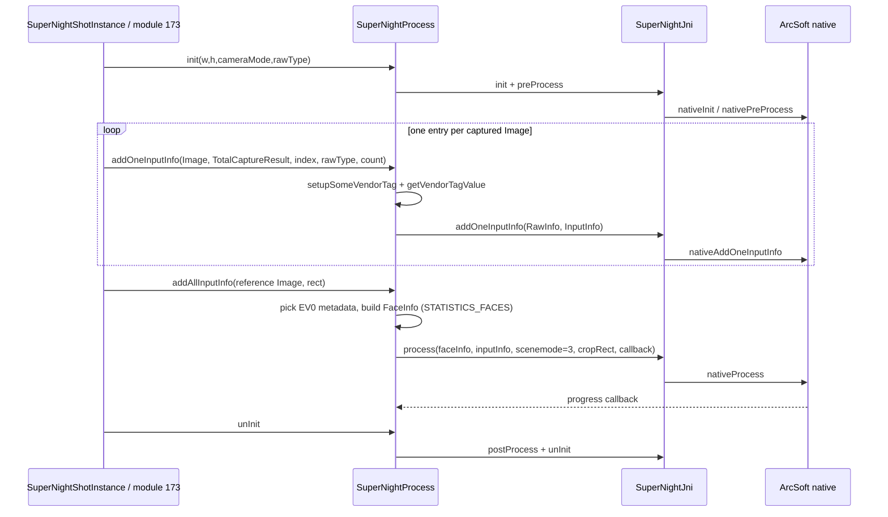
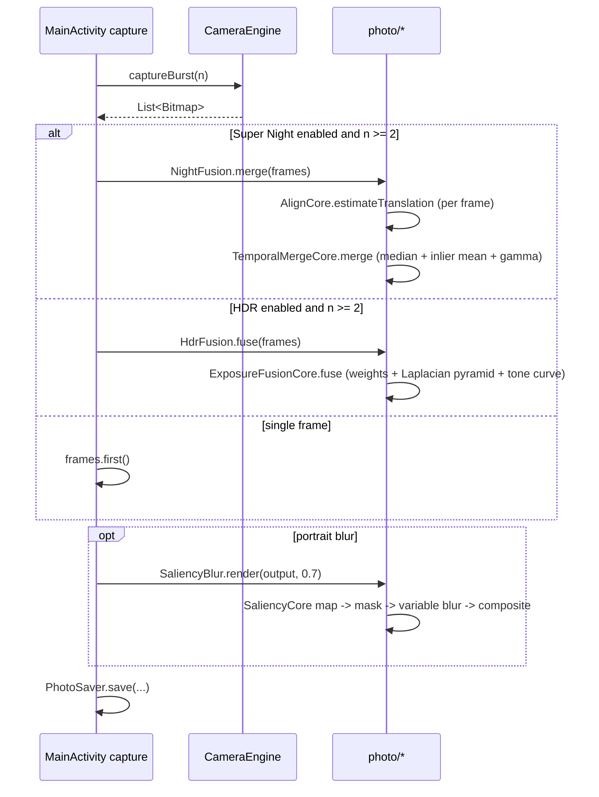
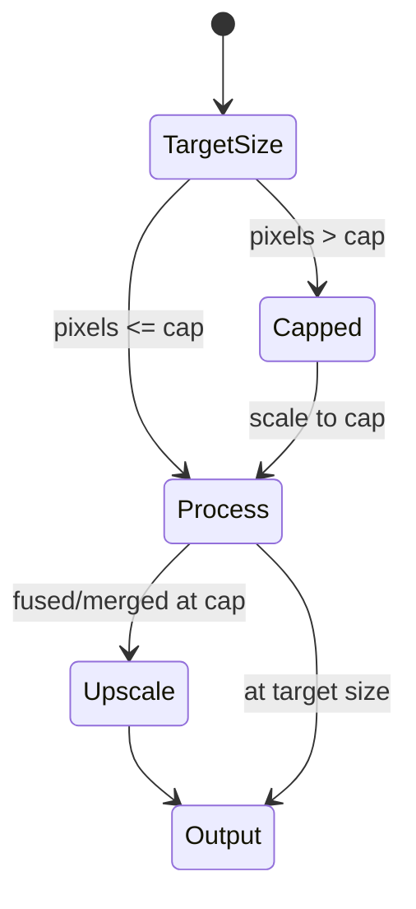

# 04 — Computational photography

Scope: catalog of the computational-photography surface of MIUI Camera
5.1.001140.0 (Poco F4 / `munch`, SM8250), the stock classes and vendor libraries
behind each feature, and the subset reimplemented in `dev.pocof4.camera.photo`.

All paths below are relative to the repository root.

- Stock Java: `decompiled2/sources/...`
- Stock resources: `apktool_out/res/...`, `apktool_out/assets/...`
- Native libraries: `native/lib/arm64-v8a/...`

`[INFERENCE]` marks conclusions that are not directly stated in decompiled Java
(typically HAL/native behaviour).

Not every vendor library is present in the curated `native/lib/arm64-v8a`
subset: the ArcSoft Super Night and FenShen clone/time-freeze `.so` files are
loaded by name from the system/vendor image. Their names below are taken
verbatim from `System.loadLibrary` / `Runtime.loadLibrary` calls.

---

## 1. Feature catalog

| # | Feature | Stock entry points / settings | Stock classes | Vendor / native | Evidence |
|---|---------|-------------------------------|---------------|-----------------|----------|
| 1 | HDR (still) | `pref_camera_hdr_key` (`KEY_CAMERA_HDR`); values `off`, `auto`, `normal`, `on`, `live` | `ComponentConfigHdr`, `HDRManager`, `HdrTrigger`, `FunctionHdrDetect` | HAL HDR checker (`setHDRCheckerEnable`, `HDRMode`); no Java fusion | `CameraSettings.java:191`; `ComponentConfigHdr.java:19-26,57-70`; `HDRManager.java:26-35,62,212-253`; `HdrTrigger.java:7-31` |
| 2 | Super Night (still, RAW) | module 173; shot types 16 / 5 / 8; `pref_camera_super_night_mode` | `SuperNightShotTypeHandler`, `SuperNightProcess`, `SuperNightJni`, `NightManager`, `SuperNightCbImageImpl`, `SuperNightShotInstance` | `libarcsoft_supernight_jni.so`, `libarcsoft_sn_mtk_apu.so`, `libarcsoft_super_night_raw_mtk.so`, `libarcsoft_super_night_raw_mpbase.so` | `SuperNightShotTypeHandler.java:19-43`; `SuperNightJni.java:11-14`; `SuperNightProcess.java:24-101,933-945`; `CameraSettings.java:222,2886` |
| 3 | MFNR (multi-frame noise reduction) | `pref_camera_mfnr_sat_enable_key`; automatic in low light | `ShouldDoMFNRSimpleASD`, `NightManager`, `LocalParallelService`, `PixelModule` | HAL MFNR (`isAnyRequestIsHWMFNRProcessing`), vendor SAT/Mivi tags | `CameraSettings.java:200,2608`; `ShouldDoMFNRSimpleASD.java`; `LocalParallelService.java:394-399`; `PixelModule.java:109` |
| 4 | Portrait depth / bokeh (still) | module 163 (SAT portrait) / 171 (bokeh portrait), `pref_portrait_hdr_key` | `PortraitUtil`, `BokehVendor`, `PortraitDepthMap`, `PortraitDepthMapExif`, `PortraitModule` | Vendor bokeh: MI (`mi_portrait`), ArcSoft (`portrait`), Megvii (`megvii_portrait`, `megvii_portrait_google`); depth map produced in native [INFERENCE] | `PortraitUtil.java:9-34`; `BokehVendor.java`; `PortraitDepthMapExif.java:6-49`; `NightManager.java:216`; `CameraSettings.java:358` |
| 5 | Ultra-Pixel / 48 MP remosaic | `pref_ultra_pixel` (`KEY_ULTRA_PIXEL`), `pref_camera_ultra_pixel_portrait_mode_key` | `ComponentRunningUltraPixel`, `PixelModule` | Sensor/HAL remosaic; Java only selects `REAR_0x2` (48 M) style values | `CameraSettings.java:420-421`; `ComponentRunningUltraPixel.java:25-32`; `PixelModule.java:43,109` |
| 6 | Motion detection (slow motion 3840 fps) | `pref_camera_motion_detection`, `pref_camera_motion_detection_range`; module 172 | `MotionDetectionView`, `FragmentSlowMotionView`, `CameraSettings.isAlgo3840AndMotionDetection` | 960/1920/3840 fps sensor modes in HAL; motion rectangle tracked in HAL/native [INFERENCE] | `CameraSettings.java:202-203,1118,2090-2091,2611`; `FragmentSlowMotionView.java:34,51,72-78` |
| 7 | Long exposure | `KEY_QC_EXPOSURETIME`; night long-exposure state | `NightManager.isLongExpCaptureInCaptureMode`, `MiviSuperNightData` | HAL long-exposure / LLS + Mivi night pipeline | `NightManager.java:134-136`; `CameraSettings.java:2214` |
| 8 | Fast motion (time-lapse / hyper-lapse) | `pref_fast_motion_key`, `pref_fast_motion_hdr_key`, `pref_fast_motion_pro_key` | `ComponentRunningFastMotion*`, `FragmentFastMotion*` | `libvideo_extra_interpolator.so` (frame interpolation), `libvideo_extra_color_converter.so`; encoder timestamps | `CameraSettings.java:266-268`; `com/miui/extravideo/interpolation/InterpolatorJNI.java`; `native/lib/arm64-v8a/libvideo_extra_interpolator.so` |
| 9 | Time freeze | time-freeze mode (clone family) | `TimeFreezeModule` (extends `CloneModule`), `TimeFreezeModeUI`, `TimeFreezeModuleDevice` | FenShen SDK native (`fenshen_snpe`, `fenshen_apu_v4/v3`) | `TimeFreezeModule.java:30,444`; `FenShenCam.java:70-74,111-126`; `apktool_out/assets/time_freeze_use_guide_cv.mp4` |
| 10 | Clone (photo / video) | clone mode; `MCOPY` edit | `CloneModule`, `FragmentCloneProcess`, `FenShenCam` | FenShen SDK native; max 4 photo subjects, 2 video subjects | `CloneModule.java:93`; `FenShenCam.java:15-16,28-110`; `apktool_out/assets/clone_photo_mode_use_guide_cv.mp4` |
| 11 | Dolly zoom | dolly-zoom mode; 15.45 s capture window | `DollyZoomModule`, `MediaEffectCamera` | Vendor media-effect pipeline; not named in Java [INFERENCE] | `DollyZoomModule.java:76-77,467`; `MediaEffectCamera.java:12-49`; `apktool_out/assets/dollyzoom/` |
| 12 | Super Night video | module 214, `pref_camera_super_night_video_quality` | `SuperNightVideoModule` (extends `VideoModule`), `NightVideoModuleEntry` | Encoder + HAL night processing; no Java fusion | `NightVideoModuleEntry.java`; `SuperNightVideoModule.java:13`; `CameraSettings.java:223` |
| 13 | HDR10 / HLG / HDR10+ video | `pref_hdr10_video_mode_key`, `pref_hlg_video_mode_key`, `pref_hdr10plus_video_mode_key` | `CameraConfigs`, `CaptureRequestBuilder`, `HDR10ThumbnailUtil`, `ColorSpace` | Codec/display HDR (`MediaCodec`, vendor encoder); no Java pixel processing | `CameraSettings.java:287-289`; `storage/HDR10Thumbnail/HDR10ThumbnailUtil.java`; `com/xiaomi/renderengine/ColorSpace.java` |
| 14 | AI saliency (AF region) | automatic AF assist | `SaliencyChecker`, `FocusManager.processSaliencyChecker/initSaliencyChecker` | `libmialgo_saliency_jni.so`, `libmialgo_saliency.so`; assets/ADSP under `/vendor/etc/camera`, `/vendor/lib/rfsa/adsp/` | `SaliencyChecker.java:13-14,24,41-118`; `FocusManager.java:522-568,839-859` |
| 15 | Document enhancement | document mode | `DocModule`, `DocumentView`, `FragmentDocView` | `libDocumentProcess.so`, `DocumentProcessJNI` | `features/mode/doc/DocModule.java:53,125-163`; `com/xiaomi/ocr/sdk/imgprocess/DocumentProcessJNI.java` |
| 16 | GPU effects / watermark | filter, watermark | `ShaderNativeUtil` | `libCameraEffectJNI.so`, `libYuvWatermark.so` | `effect/ShaderNativeUtil.java:12-14`; `native/lib/arm64-v8a/libYuvWatermark.so` |
| 17 | Super Moon | moon shot mode; shot types 16 / 8 | `SuperMoonModule`, `AiMoonSimpleASD` | Super-resolution request + HAL/Mivi shot processing [INFERENCE] | `SuperMoonModule.java:121,1171-1174,1177-1180`; `module/interceptor/camera/AiMoonSimpleASD.java` |

### 1.1 HDR control flow

`HDRManager` owns the auto-HDR state machine. The UI value comes from
`ComponentConfigHdr` (`off`/`auto`/`normal`/`on`/`live`). The HAL HDR checker is
enabled only when the mode is `auto` or already HDR-enabled
(`HDRManager.java:233-253`). Scene-change callbacks are debounced: a change
following a user switch from ON/NORMAL to AUTO is suppressed for 800 ms
(`HdrTrigger.HDR_MODE_CHANGE_TIME_INTERVAL`, `HdrTrigger.java:8,17-31`).
Zoom above the optical ratio, motion detection, or high temperature force auto
HDR off (`HDRManager.java:212-226`). Auto flash enters `normal` HDR
(`isNeedNightHDR`, `HDRManager.java:62-71,219-222`).
`FunctionHdrDetect` is a pass-through Rx `Function<CaptureResult,CaptureResult>`
in this build; the actual checker decision arrives through the vendor tag and
`Camera2Proxy.HdrCheckerCallback` [INFERENCE from its empty body].

### 1.2 Super Night (ArcSoft RAW)

Entry: module index 173 (`SuperNightShotTypeHandler.couldProcess`,
`SuperNightShotTypeHandler.java:19-23`). The handler returns:

* `16` — a Mivi/MTK "algo-up" night path (`o00oOo()`),
* `5` — half algo-up or mismatch,
* `8` — algo-up with RAW callback type set,
* `0` — otherwise (`SuperNightShotTypeHandler.java:25-42`).

The Java layer only marshals data. `SuperNightProcess` accepts up to 20 RAW/YUV
images (`ARC_SN_MAX_INPUT_IMAGE_NUM = 20`), 10/12/14/16-bit Bayer layouts
(`ASVL_PAF_RAW*` constants, lines 41-99), per-frame EV, and MTK vendor tags for
black level, bright level, WB gain, shutter, sensor/ISP/ADRC/total gain, lux and
exposure index (`SuperNightProcess.java:100-166,360-452`).

Processing sequence (`SuperNightProcess.java`):



`scenemode = 3` is `ARC_SN_SCENEMODE_LOWLIGHT`
(`SuperNightProcess.java:35`; call sites `:595,713,844,941`). `cameraState = 2`
(`ARC_SN_CAMERA_STATE_HAND`). Face rectangles from
`CaptureResult.STATISTICS_FACES` are scaled into the RAW buffer; the Bayer crop
rectangle is snapped to even coordinates (`SuperNightProcess.java:250-360`). A `CountDownLatch` and
`mIsCancel` implement cancellation; `ProgressCallback.onProgress` is the only
progress signal (`SuperNightProcess.java:115-145`).

Libraries loaded (`SuperNightJni.java:11-14`): `arcsoft_supernight_jni`,
`arcsoft_sn_mtk_apu`, `arcsoft_super_night_raw_mtk`,
`arcsoft_super_night_raw_mpbase`. The MTK APU variants are platform-specific;
on SM8250 the MPBASE path is used [INFERENCE: the Poco F4 is Qualcomm, but the
Java loader is shared across Xiaomi builds].

`NightManager` adds the Mivi short-capture animation and HAL super-night EXIF;
`SuperNightCbImageImpl` reacts to `onSuperNightChanged` by flipping
`CameraSettings.setSuperNightOn` (`SuperNightCbImageImpl.java:81-118`).

### 1.3 Portrait depth / bokeh

The depth map is delivered as a side channel next to the JPEG:
`PortraitDepthMapExif` carries the depth buffer length, algorithm name,
rotation, lighting pattern, watermark overlays and a `PictureInfo`
(`PortraitDepthMapExif.java:6-49`). The algorithm name selects the vendor:
`mi_portrait` (MI), `portrait` (ArcSoft), `megvii_portrait`,
`megvii_portrait_google`, `soft-portrait`, `soft-portrait-enc`, `ambilight`
(`PortraitUtil.java:9-34`), keyed by `BokehVendor`
(0 = MI, 1 = ArcSoft, 2 = Megvii, 3 = Megvii-Google, 255 = invalid).
Night/bokeh interaction uses module 163 (SAT) and 171 (bokeh)
(`NightManager.java:216`).

Video bokeh is a separate effect: modes blur / color retention / color point /
zoom / spin, each a 0-100 ratio with default 60
(`VideoBokehConstant.java`), applied by the render engine.

### 1.4 Saliency

`SaliencyChecker` is a singleton wrapping a native handle. Initialisation takes
image size, a scale ratio, a default box and two vendor paths
(`/vendor/etc/camera`, `/vendor/lib/rfsa/adsp/`); processing takes a byte buffer
in `RGB`, `RGBA`, `NV21` or `NV12` with stride, orientation and a sub-rectangle,
and returns a modified rectangle (`SaliencyChecker.java:41-118`,
`saliencychecker/data/SaliencyProcessInputObject.java`).
The only stock consumer is autofocus: `FocusManager.processSaliencyChecker`
around line 522 refines the AF region from the preview pixels; `initSaliencyChecker`
at line 839 uses the preview size. It is **not** the portrait bokeh matte in this
build.

---

## 2. Implemented vs hardware/vendor-bound

| Feature | Reimplementation | Status |
|---------|------------------|--------|
| HDR still | `ExposureFusionCore` (Mertens pyramid fusion) + `HdrFusion` wrapper | Implemented on LDR frames (2-5). Not a reconstruction of the HAL HDR checker or RAW HDR. |
| Night / MFNR | `TemporalMergeCore` (align + median-gated mean + shadow gamma) + `NightFusion` | Implemented approximation of the *result*; no RAW processing, no vendor tone mapping, no Mivi animation. |
| Burst alignment | `AlignCore` (pyramid SAD / gradient search) | Implemented, integer translation only. |
| Saliency | `SaliencyCore` (multi-scale centre-surround + local contrast) | Implemented approximation of saliency; used for subject-aware blur, not AF. |
| Portrait bokeh | `SaliencyBlur` (saliency matte + progressive variable blur) | Implemented monocular approximation. **Not** the stock depth-map bokeh; no depth EXIF, no lighting patterns, no video bokeh modes. |
| AI saliency | `SaliencyCore` | Implemented pure-Kotlin; stock vendor model unavailable. |
| Ultra-Pixel / 48 MP | — | Hardware/HAL-bound: remosaic requires sensor mode + ISP; Java can only request it. |
| Super Night RAW | — | Vendor-only: `libarcsoft_super_night_raw_*`, MTK APU, vendor tags. Cannot be reproduced from an LDR APK. |
| Super Moon | — | Shot type + super-resolution request are HAL/Mivi-bound. |
| Motion detection / 960-3840 fps | — | Sensor/HAL-bound. |
| Long exposure | — | HAL-bound (sensor + LLS/Mivi). |
| Fast motion / interpolation | — | MediaCodec + vendor interpolator; not implemented. |
| Time freeze | — | FenShen vendor native (SNPE/APU). |
| Clone | — | FenShen vendor native. |
| Dolly zoom | — | Vendor media-effect pipeline. |
| Super Night video | — | HAL night video + encoder; wrapper module only. |
| HDR10 / HLG / HDR10+ video | — | Encoder/display pipeline (`MediaCodec`, color spaces, HDR10 thumbnail LUT). |
| Document enhancement | — | `libDocumentProcess.so`. |

Honest summary: only the **frame-domain** computations (alignment, exposure
fusion, temporal merge, saliency matte) are reproducible from the APK. Every
RAW-domain, sensor-mode, codec and vendor-model feature is hardware- or
vendor-bound.

---

## 3. Reimplementation mapping

| Stock component | Reimplementation | Notes |
|-----------------|------------------|-------|
| ArcSoft Super Night RAW (`SuperNightProcess`) | `TemporalMergeCore`, `NightFusion` | Same goal (noise reduction from a burst), different domain (LDR ARGB). |
| HAL/HDR checker + HDR still path | `ExposureFusionCore`, `HdrFusion` | Software Mertens fusion instead of HAL HDR. |
| (none — stock delegates alignment to native) | `AlignCore` | Shared by HDR and night; also usable for future MFNR. |
| `SaliencyChecker` (AF) | `SaliencyCore.map/subjectMask` | Different algorithm (no FFT), same concept. |
| Portrait depth + vendor bokeh | `SaliencyBlur` | Monocular saliency mask instead of a depth map. |
| `PortraitDepthMapExif` | — | Not reimplemented (no depth buffer). |
| `ComponentRunningUltraPixel` | — | UI/setting only in stock; HAL does the work. |
| `FenShenCam` clone/time-freeze | — | Vendor native. |
| `MediaEffectCamera` dolly zoom | — | Vendor native. |

### 3.1 Module layout

```
reimpl/app/src/main/java/dev/pocof4/camera/photo/
  ImageMath.kt            pure: luma, gradients, box/tent blur, pyramids, resampling
  AlignCore.kt            pure: hierarchical translation estimator
  ExposureFusionCore.kt   pure: Mertens weights + Laplacian pyramid + tone curve
  TemporalMergeCore.kt    pure: alignment + median-gated temporal mean + gamma
  SaliencyCore.kt         pure: saliency map, feather mask, variable blur
  BitmapPixels.kt         android: Bitmap <-> IntArray, centre-crop scaling
  HdrFusion.kt            android: public Bitmap API
  NightFusion.kt          android: public Bitmap API
  SaliencyBlur.kt         android: public Bitmap API
```

Public API (used by `MainActivity`):

```kotlin
object HdrFusion     { fun fuse(frames: List<Bitmap>): Bitmap }
object NightFusion   { fun merge(frames: List<Bitmap>): Bitmap }
object SaliencyBlur  { fun render(bitmap: Bitmap, strength: Float): Bitmap }
```

Pure cores never import `android.*`, so the JVM unit tests exercise the real
algorithms.

---

## 4. Algorithm details and complexity

### 4.1 Alignment (`AlignCore`)

* Input: packed ARGB_8888 planes; luma is derived internally.
* Gaussian pyramid, 1-5 levels, built by 2x2 box averaging; level shift radius
  is `ceil(maxShift / 2^level)`.
* Coarsest level: exhaustive search of the full radius. Finer levels: +/-2 px
  around twice the previous estimate. Search is clamped to
  `min(maxShift, shortEdge/4)`.
* Cost: mean absolute difference over a fixed grid (~96x96 samples,
  independent of resolution) on luma (`SAD`) or luma gradient (`GRADIENT`).
  Gradient cost is exposure-invariant, so HDR brackets use it.
* Ambiguity guard: the winning shift must reduce the level-0 cost by at least
  3 % relative to zero shift; otherwise `Shift(0,0)`. This prevents noise-only
  night frames from jittering.
* Subpixel refinement is intentionally omitted: 1 px residual is below the
  hand-held burst blur floor, and it avoids bilinear resampling of every frame.

Complexity: `O(levels * candidates * samples)`; candidates are at most
`(2*maxShift+1)^2` only at the coarsest (tiny) level, then 25 per level.
For a 12 MP frame with `maxShift=24` this is a few million comparisons
[INFERENCE: measured only on the JVM test images].

### 4.2 Exposure fusion (`ExposureFusionCore`, `HdrFusion`)

* Weights (Mertens et al. 2007): contrast `|Laplacian(luma)|`, saturation (RGB
  standard deviation), well-exposedness (product of Gaussians centred on 0.5,
  sigma 0.2). Weights are normalised across frames at every pyramid level.
* Laplacian pyramid of each channel and each frame, weight-Gaussian pyramid,
  per-level weighted sum, collapse. Default 3 levels (configurable 1-4),
  clamped by image size.
* Output tone curve: linear to 0.9, then a smooth exponential shoulder towards
  1.0. It is monotonic and prevents hard clipping of Laplacian overshoot.
* Input frames: 2-5. Mixed sizes are scaled/cropped to the smallest common
  size (`BitmapPixels.toPixels`, centre-crop fill). Processing is capped at
  3 MP (`HdrFusion.MAX_FUSION_PIXELS`) and the result is scaled back.

Peak heap ≈ `frames * levels * 1.33 * pixels * 4 B` (channel-at-a-time) plus
the weight pyramids and the input IntArrays; about 150 MB at 3 MP with 3
frames. At 12 MP the pyramids would need >500 MB, hence the cap.

### 4.3 Night merge (`TemporalMergeCore`, `NightFusion`)

* Align every frame to frame 0 (SAD metric), then per channel:
  median via insertion sort (n <= 20), mean of samples within
  `outlierTolerance` (default 20/255), fallback to the median if all samples
  are rejected.
* Shadow lift: `out = 255 * (v/255)^(1/gamma)` with gamma 1.35 (configurable,
  LUT of 256 entries). No per-pixel allocations.
* `NightFusion` uses an adaptive cap: total copied input pixels are limited to
  30 MP, so a 5-frame burst runs at 6 MP/frame, a 3-frame burst at 10 MP and a
  2-frame burst at 12 MP. Peak heap for the IntArray planes is
  `(frames + 1) * pixels * 4 B` (e.g. ~144 MB for 5 x 6 MP), plus one luma pair
  during alignment. Input Bitmaps owned by the caller are extra.

### 4.4 Saliency and bokeh (`SaliencyCore`, `SaliencyBlur`)

* Map: luma pyramid (<=5 levels); centre-surround differences for
  `c in {0,1}, s in {c+2,c+3}`; plus local contrast at radii 2 and 5; one
  robust p98 normalisation shared by all scales (so weak background texture is
  not amplified); mild pooling (radius = shortEdge/16, factor 0.55) to fill
  object interiors; final 3x3 smoothing.
* Saliency computation is capped at 300k pixels internally and bilinearly
  resampled.
* Mask: `smoothstep(0.18, 0.55)` then feathering with a 3-pass box blur of
  radius `shortEdge/50`.
* Blur: 5-level progressive stack (radii 0..`strength*5%` of short edge),
  3-pass box blur per level; per-pixel radius interpolation between levels.
  It is bokeh-*like*; the aperture is not a true disc and highlight bloom is
  absent.
* Composite: `lerp(blurred, original, mask)`, so subject pixels are exactly
  the input pixels.
* `SaliencyBlur` caps processing at 2 MP; above that it upscales the mask and
  blurred image and composites against the full-resolution original, keeping
  the subject sharp.

---

## 5. Reimplementation control flow



State machine of the wrapper-level size policy:



---

## 6. Deviations and limitations

1. **LDR, not RAW.** The reimplementation fuses JPEG/YUV frames. It cannot
   recover the 12-bit headroom, per-frame gains or black level that
   `SuperNightProcess` receives.
2. **No vendor tone mapping.** ArcSoft applies its own local tone mapping,
   denoise and sharpening. `ExposureFusionCore` uses a global soft-shoulder
   curve; `TemporalMergeCore` uses a global gamma.
3. **Mertens is exposure-agnostic.** Without linearising and compensating
   exposure, very bright regions are placed near mid-grey by weight selection.
   This is standard Mertens behaviour and is visible when bracketing more than
   ~2 EV; the tests assert detail recovery and no clipping, not absolute scene
   luminance.
4. **Integer translation only.** No rotation, no homography, no rolling-shutter
   compensation.
5. **Saliency is not a depth map.** A subject with no texture or contrast can
   be blurred; a busy background can steal part of the mask. Portrait depth
   EXIF/lighting effects are not produced.
6. **Bokeh is Gaussian-like, not a true aperture disc.** No highlight bloom,
   no cat-eye shaping, no anamorphic effects.
7. **Resolution caps.** HDR 3 MP, night 6-12 MP depending on burst length
   (30 MP total input budget), saliency 2 MP. Results above the cap are
   upscaled.
8. **Video features are entirely absent** (Super Night video, HDR10/HLG,
   fast motion, dolly zoom, clone video, time freeze).

---

## 7. Verification

### 7.1 JVM unit tests

Location: `reimpl/app/src/test/java/dev/pocof4/camera/photo/`.

| Test | Proves |
|------|--------|
| `AlignmentCoreTest.recoversInjectedTranslation` | exact recovery of an injected (+5,-3) shift on a textured 128x96 frame |
| `AlignmentCoreTest.recoversNegativeTranslationOnSecondPattern` | (-4,+2) with SAD metric |
| `AlignmentCoreTest.flatFramesReturnZeroShift` | ambiguity guard rejects noise |
| `ExposureFusionCoreTest.fusesDarkMediumBrightFramesWithoutClipping` | dark bracket clips shadows, bright bracket clips highlights; fused output keeps texture in both halves and contains no 0/255 pixels |
| `ExposureFusionCoreTest.acceptsTwoFramesAndRejectsOne` | 2..5 frame contract |
| `ExposureFusionCoreTest.toneCurveIsMonotonicAndCompressesHighlights` | monotonic, bounded, no hard clip at 1.0/2.0 |
| `TemporalMergeCoreTest.mergeReducesNoiseVarianceVersusSingleFrame` | merged variance < 50 % of a single noisy frame |
| `TemporalMergeCoreTest.outlierFrameIsRejectedByMedianGate` | a +110-level blob in one frame is rejected |
| `TemporalMergeCoreTest.shadowLiftBrightensDarkTones` | gamma lifts 20 to ~39 |
| `TemporalMergeCoreTest.alignedMergeRestoresTranslatedBurstFrames` | 3 translated frames merge back to the reference (mean error < 6/255) |
| `SaliencyCoreTest.saliencyMapLocalizesSyntheticSubject` | subject mean > 0.5, background < 0.2, peak inside subject |
| `SaliencyCoreTest.renderKeepsSubjectSharpAndBlursBackground` | subject gradient energy >= 85 % of input, background <= 50 % |
| `SaliencyCoreTest.zeroStrengthIsIdentity` | no-op path |

Run (coordinator/CI only): `./gradlew :app:testDebugUnitTest`.

### 7.2 On-device checks

* HDR: shoot a backlit window at 2-5 EV spread; compare against a single frame:
  highlights on the window frame should not be pure white, shadow texture
  should survive.
* Super Night: dim indoor scene, 3-5 frame burst; measure variance on a flat
  wall patch — it should drop by roughly `1/sqrt(n)` relative to one frame,
  while a moving object must not produce ghosts (median gate).
* Portrait blur: subject at 0.5-2 m, busy background; subject edges must stay
  sharp, background texture should be smoothed; strength 0 must be a no-op.
* Size caps: capture at 48/64 MP; confirm processing completes without OOM and
  output dimensions equal the smallest input frame (HDR/night) or the original
  (saliency).

Performance expectations below are from algorithm complexity, not measured on
the Poco F4 [INFERENCE]: alignment ~10-30 ms per 12 MP pair on a modern
big core; night merge ~100-300 ms for 5 x 6 MP; HDR fusion ~0.8-2 s for
3 x 3 MP; saliency + blur ~200-500 ms at 2 MP. All are still-capture paths, not
preview-rate.
